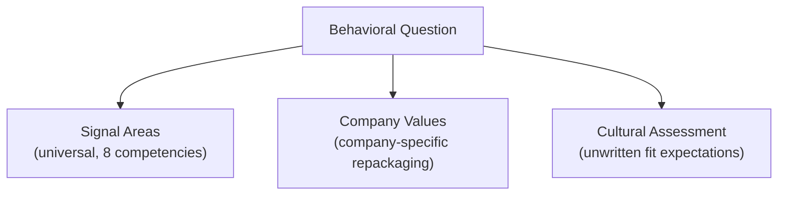

# Decode: How Interviews Work

*Source: HelloInterview — Behavioral Interviews course, "Decode" lesson.*

## Study focus

- **Read closely:** The Three Evaluation Frameworks, all 8 Signal Area deep dives, and The Three Question Types. The signal areas are what's actually being scored.
- **Know cold:** the 8 signal areas, one phrase each — Scope (size of the box), Ownership (drive it end-to-end), Ambiguity (move with incomplete info), Perseverance (push through obstacles), Conflict Resolution (initiate, don't avoid), Growth (learn from mistakes), Communication (adapt to audience), Leadership (influence without authority).
- **Recognize live:** which of the three question shapes you're facing — a past story, a hypothetical, or a values question.

## Quick Summary

- Unlike a coding interview, there's no way to "test" a behavioral answer against expected output — the only fix is understanding how interviewers actually evaluate you, so you can self-assess
- Every question is filtered through three lenses, consciously or not: **Signal Areas** (8 universal competencies), **Company Values** (company-specific repackaging of the same competencies), and **Cultural Assessment** (unwritten fit expectations)
- Three question *shapes* exist — "Tell me about a time..." (by far the most common, wants a real story), Hypotheticals (tests judgment when experience is thin), and Values questions (tests philosophy/mindset) — recognizing which one you're facing shapes how you should answer
- The 8 Signal Areas are the real backbone of the whole course: Scope, Ownership, Ambiguity, Perseverance, Conflict Resolution, Communication, Growth, Leadership

## The Core Problem This Solves

Behavioral prep is uniquely hard to self-grade — you walk out not knowing if you nailed it, with no way to execute your answer against a known-good result. The fix is understanding the evaluation machinery underneath the question, so "decoding" becomes a learnable skill rather than guesswork.

Interviewers are fundamentally **forecasters**: they care less about the specific plot of your story and more about what it predicts about how you'll behave in their environment. This is also why the same candidate can thrive in one company's behavioral and struggle in another's — the *behaviors* that succeed differ by environment, not the underlying skill level.

## The Three Evaluation Frameworks

### 1. Signal Areas — the universal layer

Eight standardized, observable competencies that nearly every behavioral question maps back to, regardless of how a specific company documents or names them internally. A single strong story often hits several at once (e.g., a conflict story is primarily Conflict Resolution, but usually carries Communication and sometimes Perseverance or Leadership too).

### 2. Company Values — repackaged, not replaced

Company values (Amazon's Leadership Principles, Google's "Focus on the user," Meta's "Move Fast") are not a separate axis from Signal Areas — they're the same underlying competencies wearing different vocabulary. Amazon's "Ownership" principle *is* the Ownership signal area; Meta's "Move Fast" blends Ownership and Perseverance.

**Practical weight varies by company.** Amazon genuinely operationalizes its 16 Leadership Principles into daily work — knowing the exact language matters there. At most other companies (Meta, Google, most startups), values live mostly on websites/walls and rarely surface in actual interviewer behavior; the underlying signal areas still dominate.

**The trap to avoid: "value-dropping."** Memorizing company values and forcing them awkwardly into every answer is transparent to trained interviewers. Let company language *inform* word choice where it fits naturally — don't force it.

Occasionally a company has a genuinely unique value that doesn't map cleanly onto the 8 (e.g., OpenAI's "Creativity over control") — these deserve extra attention precisely because they exist for a specific, deliberate reason.

### 3. Cultural Assessment — pattern-matching against "successful people here"

The least conscious, hardest-to-prep-for layer: interviewers unconsciously compare you against the successful engineers they already know. This covers things like your relationship to authority/hierarchy, how you talk about results, and your speed-vs-quality instincts — there's no universally "right" answer here, only "right for that specific company." Moving between very different company cultures (e.g., traditional enterprise → Big Tech) is a real, common source of confusing rejections or downleveling, since the underlying behaviors can actually be fine but just don't read correctly to that audience.

## The Three Question Types

| Type | Frequency | Tests | Example |
|---|---|---|---|
| **"Tell me about a time..."** | Most common by far | Specific past behavior — the strongest predictor of future behavior | "Tell me about a time you influenced without formal authority." |
| **Hypotheticals** | Less common | Judgment, when real past experience may be thin | "What would you do if your manager asked you to cut a feature to hit a deadline?" |
| **Values questions** | Less common | Mindset/philosophy, alignment with company culture | "What does ownership mean to you?" |

Most prep time should go toward "Tell me about a time..." questions, since they dominate real interviews.

## Signal Area Deep Dives

For each area: what's really being assessed, and the concrete behaviors that demonstrate it.

**Scope** — the "size of the box" you operate in; does your past impact match the target level? Shown through story choice itself, breadth of actions (technical-only vs. also planning/communicating/stakeholder-managing), timescale, and depth of reflection. **Using a junior-level example for a senior role is a classic, direct cause of downleveling.**

**Ownership** — not just flagging a problem, but driving the fix end-to-end and measuring whether it actually worked. The single biggest tell: language. "I talked to the manager" vs. "we solved the problem" — passive/collective phrasing erases your individual signal, and the interviewer is evaluating *you*, not your team.

**Ambiguity** — tolerance for incomplete information correlates directly with seniority, since higher-level work inherently has more uncertainty. What candidates consistently under-tell: *how* they actually created clarity (data? conversations? past experience?) and how they validated their assumptions afterward.

**Perseverance** — what you do when things get hard, since things always get hard eventually. Two nuances: knowing *when to quit* a project is itself strong signal (not a failure to hide), and "martyr stories" (nights/weekends) can actually read as poor planning rather than dedication — emphasize creative problem-solving over raw hours.

**Conflict Resolution** — tech companies explicitly value direct, healthy conflict; "I'm not one to create conflict" is one of the worst possible openers. Strong behaviors: initiating hard conversations rather than avoiding them, seeking to understand before advocating, finding real resolutions, and preserving the relationship afterward. Story scope should match your target level — a peer disagreement reads junior for a Staff interview; a conflict with a manager or across orgs reads more appropriately senior.

**Growth** — whether you improve over time and are coachable. Real signal: honestly owning a mistake, extracting a specific lesson, and later demonstrating changed behavior. Two failure modes to avoid: "humble-brag" weaknesses with no real downside ("I care too much"), and mistakes so basic for your level that they raise real maturity doubts.

**Communication** — evaluated two ways simultaneously: *how* you're telling the story right now (framing, efficiency, directness) and what the story itself shows about your communication behaviors (audience-adapting, channel choice, proactive updates). Describe the *when* and *how*, not just the *what* — "I messaged the tech lead directly given the sensitivity, then presented to the full team once aligned" is far stronger than "we agreed on the proposal."

**Leadership** — matters for ICs too, no direct reports required. Influencing through expertise/relationships/vision, building consensus, mentoring, representing the team externally. Senior candidates often under-report the leadership threads already present in their existing stories (convincing a manager to fund something, unsticking a junior engineer) — these are worth deliberately surfacing, not treating as incidental.

## Exercise: Research Your Target Companies

Before moving to the next lesson: find the target company's published values, research what's known about their specific behavioral practices (community sources, company-specific threads), then map each published value back to the 8 signal areas above. Once that mapping clicks, the rest of prep gets much simpler — you're not learning a new framework per company, just translating vocabulary.

## Key Terms

- **Signal Areas** — the 8 universal, observable competencies (Scope, Ownership, Ambiguity, Perseverance, Conflict Resolution, Communication, Growth, Leadership) that nearly every behavioral question maps to
- **Company Values** — company-specific language repackaging the same underlying signal areas, not a separate assessment axis
- **Cultural Assessment** — the unconscious "do you pattern-match to our successful people" layer; no universal right answer, only company-specific fit
- **Value-dropping** — the failure mode of forcing memorized company-values language into answers; transparent to trained interviewers
- **"Tell me about a time..."** — the dominant question format, testing specific past behavior as the strongest predictor of future behavior
