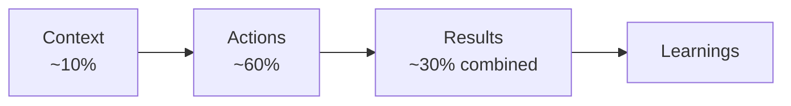

# Deliver: Telling a Good Story

*Source: HelloInterview — Behavioral Interviews course, "Deliver" lesson.*

## Study focus

- **Read closely:** CARL, the worked example (for its *shape*), the Context mistakes, Actions in full (including the action categories), Results when you have no metrics, Learnings, and the Table of Contents technique.
- **Know cold:** CARL = Context, Actions, Results, Learnings · time split **~10% / ~60% / ~30%** · every action sentence is an "I" sentence · the 30-second rule.
- **Write:** full CARL prose for your leadership/scope-growth story — a real *before* scope and a real *after* scope, not a project summary — and for your technical ownership story.

## Quick Summary

- Our brains are wired to process and remember stories specifically — structured narrative beats a flat list of accomplishments for interview purposes
- **CARL** (Context, Actions, Results, Learnings) replaces STAR: same spine, but explicitly adds reflection and merges Situation/Task (which blur together anyway) into one Context section
- Rough time budget inside a story: **~10% Context, ~60% Actions, ~30% Results + Learnings**
- Use "I" relentlessly in Actions — this is where the actual evaluated signal lives
- Long/complex stories need a **Table of Contents** opener (themed roadmap) so the interviewer doesn't get lost; front-load Results if you expect heavy interruption
- Prepare the 4 recurring follow-ups for every core story: *What would you do differently? What was the hardest part? How did you measure success? What happened after?*

## Why Structure Matters: STAR's Real Gaps

STAR (Situation, Task, Action, Result) isn't wrong, but has two concrete weaknesses, especially for senior candidates:
- **No explicit place for reflection** — for senior roles specifically, interviewers want to see that you extract and reuse wisdom from past mistakes; STAR gives you nowhere to show that.
- **Situation and Task blur together** — candidates waste real prep time trying to artificially separate "what was happening" from "what I needed to do," especially on larger projects where the distinction is genuinely fuzzy.

**CARL** fixes both: Context merges Situation+Task (how much setup the listener needs to understand your Actions), Actions stays the centerpiece, Results shows the outcome, and Learnings is added as a natural closing beat — think Aesop's fables, where the moral is the expected final note, not an afterthought.

## Reading a Full Worked Example

The course walks through a complete CARL answer to "Tell me about a time you persevered through an obstacle" (a mid-level engineer building an AI chatbot for an overwhelmed support team). Worth internalizing the *shape*, not memorizing the content:

- Opens with the so-what immediately (200 tickets/day, resolution-time goal) — stakes established in the first few sentences, not buried.
- Actions braid together Ownership ("nobody asked me to do this — I brought the idea to my manager") with the actual Perseverance being tested (learning new tooling, reverse-engineering an undocumented legacy system).
- Non-technical actions get equal billing with technical ones — selling the idea to a skeptical director, running a scoped pilot, sending regular progress updates.
- Results are quantified cleanly (35% faster resolution, 60% automation, satisfaction score held steady) and followed immediately by one honest, specific Learning (should have looped in the support team earlier).
- One story naturally covers Perseverance (primary), plus Ownership, Growth, and Communication — confirming a single well-built core story reuses across multiple questions.

## Context

Orient the listener with the minimum needed to understand your Actions: company/team context only if relevant, the problem/opportunity, and — most critically — **the stakes**. Compare: "I worked on a performance project" (weak) vs. "Our checkout flow had a 40% abandonment rate, costing an estimated $2M/quarter" (strong, immediately legible).

**Keep it to 30-45 seconds.** Common failure: 1-3 minutes of setup before reaching any actual action — the interviewer checks out before the signal even starts.

**Three specific mistakes to avoid:**
- *The project history lesson* — a full origin timeline ("built in 2018, refactor attempted in 2019...") the listener doesn't need.
- *Unnecessary org chart detail* — reporting lines that aren't actually load-bearing for the story.
- *Explaining tech the interviewer already knows* — at a tech company, assume baseline literacy; don't define Kubernetes to a K8s engineer.

## Actions — Where the Signal Actually Lives

This is the evaluated core of the response; everything else is supporting material.

- **"I" statements, consistently** — "I proposed and the team agreed," not "we decided." You can credit others without erasing your own agency.
- **Both technical and non-technical actions** — scoping, communicating, mentoring, resolving conflict are often exactly what separates a Senior-sounding story from a Staff-sounding one.
- **Specificity over vagueness** — "I added distributed tracing and found our Redis pool was exhausted at peak" beats "I debugged the issue." Specificity is itself evidence you'll do the job well, not just decoration.
- **Show repeatable behavior, not just a one-off win** — the interviewer is extrapolating whether you'd succeed again under similar conditions.

**On the right amount of detail:** aim to (1) make the actions understandable and (2) establish credibility — then stop adding detail once both are achieved, since further detail just burns time. **The 30-second rule:** if 30 seconds pass without a new action moving the story forward, you're over-indexing on one point — note it's available for follow-up and move on.

**What to actually narrate inside Actions:** alternatives you considered, your reasoning for the choice made, specific technical decisions, how you handled pushback/challenges, and who you collaborated with or influenced along the way.

**Action categories to pull from:** Designing, Aligning, Communicating, Implementing, Iterating, Testing & Debugging, Releasing, Thinking & Deciding.

## Results

Prove the actions actually mattered, across business/user/team dimensions. Quantify whenever possible ("reduced p99 latency 85%, 800ms→120ms" beats "improved performance").

**When there's no clean metric** (internal tools, early-stage work, startups without measurement bandwidth), four honest fallback framings still work:
- Before/after state comparison ("deploys went from 3-person/4-hour coordination to any-engineer/15-minutes")
- Qualitative feedback from a real stakeholder
- Time/effort comparison ("weeks became days")
- What became newly possible as a direct result

## Learnings

Shows you get better over time — essential, not optional, for senior framing. **Go beyond generic** ("communication matters" is forgettable; "when working remote, I need to over-document since hallway conversations don't happen" is specific and real). Be honest about actual mistakes rather than presenting a flawless arc — a story with zero room for improvement reads as a red flag, not a strength.

## Adapting One Story to Multiple Questions

Most stories contain several distinct angles — like different movie trailers cut from the same footage emphasizing different scenes for different audiences. The same core story can answer "tell me about perseverance," "tell me about ownership," or "tell me about your communication skills" just by shifting which part gets foregrounded. Don't drop the other angles entirely — mention them briefly as available threads in case the interviewer wants to follow up.

## Reading the Room

Watch for real-time disengagement signals: glazed eyes, no technical follow-up questions, visible waiting-to-speak cues, stopped note-taking, or frequent "yeah"/"hmm" (which in an interview often means "move on," unlike normal conversation). If you spot these, cut the current thread short. Calibrate detail level to the specific listener — go deeper technically with a peer engineer, stay at the decisions/trade-offs level with a non-coding hiring manager.

## Handling Genuinely Long, Complex Stories

Senior-level, multi-month projects are hard to both deliver and listen to without structure. Fix: organize Actions into named themes and list them right after Context as a **"Table of Contents"** — e.g., *"This happened in three phases: alignment, implementation, and rollout — let me walk through each."* This helps the listener track where you are, signals organized thinking (itself a senior-level signal), and keeps you from losing your own thread if interrupted.

Make theme labels *conclusions*, not just topics — "working with the TL to design around complex constraints" beats "technical design." For sufficiently long stories, consider **front-loading Results** at the very top, since deep follow-up questions might mean you never naturally reach the end otherwise.

## Prepare for Follow-Ups

Virtually guaranteed, recurring ones: *What would you do differently? What was the hardest part? How did you measure success? What happened after?* (If your Learnings are already solid, the first one is already answered.) Also prep for categories around your specific role/contribution, the decisions you made and alternatives considered, and how relationships fared afterward.

## Key Terms

- **CARL** — Context, Actions, Results, Learnings; the course's structure, replacing STAR
- **Table of Contents technique** — naming Action themes upfront for a long/complex story so the listener can track it
- **The 30-second rule** — a signal you're over-detailing one point instead of progressing the narrative
- **Front-loading Results** — stating outcomes early in a long story, anticipating you may not reach them naturally due to interruptions
