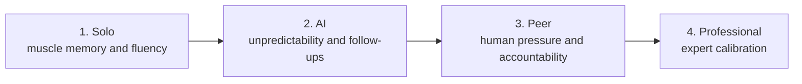

# Practicing

*Source: HelloInterview — Behavioral Interviews course, "Practicing" lesson.*

## Study focus

- **Read closely:** the solo review checklist — pacing, I vs. we, fillers, energy, organization. That's the rubric for a live run.
- **Re-check:** the four follow-ups from Deliver — *What would you do differently? What was the hardest part? How did you measure success? What happened after?* — and confirm you can answer each out loud, without notes.
- **Do:** a full timed mock — TMAY → leadership story → conflict story → AI question — with real follow-ups. Write down every follow-up that caught you off guard. The day of, no new material: one quiet read-through, nothing more.

## Quick Summary

- Practice closes the gap between what you *mean* to say and what actually comes out under real pressure — skipping it is the single biggest reason prepared candidates still underperform
- Progressive structure, low-pressure to high-pressure: **Solo → AI → Peer mock → Professional mock** — each stage serves a distinct purpose; skipping stages wastes time
- Solo recording review checklist: pacing, "I" vs. "we" ownership clarity, verbal fillers, energy, organization
- A real human mock (even a non-expert peer) provides something AI fundamentally can't: live pressure, unscripted follow-ups, and honest external feedback
- Practicing Decode→Select→Deliver as a drill (not just rehearsing fixed stories) builds the actual reflex needed live

## Why Drilling Key Points, Not a Script, Avoids Sounding Robotic

The fear that practice makes you sound rehearsed is backwards — robotic delivery comes from memorizing exact wording. Practicing the key *points* to hit (not verbatim phrasing) instead builds fluency and confidence without stiffness.

## The Progressive Practice Ladder

### 1. Solo Practice

Record yourself (phone/laptop) delivering each core story in CARL format as if speaking to a real interviewer. Don't aim for a perfect first take — the goal is simply starting to put in reps.

**Review checklist, watching your own recording:**
- **Pacing** — rough target split: ~10% Context, ~60% Actions, ~30% Results+Learnings. If you're three minutes in with zero actions described, that's a real problem.
- **Ownership clarity** — literally count "I" vs. "we." A common failure mode, especially for genuinely collaborative people who default to collective framing without meaning to erase their own contribution.
- **Verbal fillers** — "um," "like," "you know," "basically" — everyone has a pattern; watching yourself is often the first time you actually notice it.
- **Energy/engagement** — do you sound genuinely interested in your own story? If you're bored telling it, the interviewer will be too.
- **Organization** — can you follow your own narrative, or does it jump around? A clear beginning/middle/end matters a lot.

Do 2-3 takes per core story, applying the previous take's lessons each time — real, visible improvement by the third attempt is normal. **Watching playback at 1.5x speed** still catches pacing/filler issues while saving real time.

### Mastering the Big Three specifically

Given how universally these come up, they deserve extra, dedicated rep: practice until deliverable conversationally, without notes.
- **TMAY** — the first 20 seconds set the whole interview's tone; make sure the opening doesn't stumble.
- **Favorite project** — confirm transitions clearly flag your most important contributions; use Table of Contents structure if it's complex.
- **Conflict story** — balance professionalism with genuine, believable emotional content; don't over-sanitize it into blandness.

### Drilling Decode → Select → Deliver as its own reflex

Once core stories feel solid, practice the live pattern-matching itself: pull a list of behavioral questions, and for each, explicitly (1) **Decode** — what signal area is this really testing? (2) **Select** — which catalog story fits, going with instinct rather than over-deliberating, then evaluate after. (3) **Deliver** — say the full CARL response out loud as if live. This exercise is also a reliable way to surface real gaps — if a question type keeps landing on a weak-fit story, that's a signal to go build a better one for that signal area before the real interview.

### 2. Practicing with AI

A genuinely useful intermediate step: generate unfamiliar/company-specific questions, surface likely follow-ups for your existing stories (where most candidates actually get tripped up, since they rehearse the opening but not what comes after), or simulate a company-specific interviewer persona.

**Real, acknowledged limits:** AI can't replicate nonverbal feedback, true conversational interruption/tangent dynamics, genuine pressure, or emotional read — which is exactly why the next stages (real humans) still matter.

### 3. Peer Mock Interviews

Doesn't require a professional — a friend, former colleague, or an online peer-mock community works. Real, distinct value over solo/AI practice:
- **Genuine pressure** from a live human waiting on your answer
- **Real follow-ups** on the weak/vague parts of your story
- **Actionable coaching**, not just "that was good"
- **Accountability** if multiple sessions are scheduled
- **Mental-health-relevant encouragement** during what's often a genuinely stressful process

**Setting your peer up to actually help:** give them coverage across signal areas (not clustered on one type), a simple evaluation rubric (Structure/Story choice/Story depth/Delivery, 1-5 each), explicit instruction to ask real follow-ups, and explicit permission to give *honest*, specific critique rather than encouragement. Recording the session (with permission) often reveals habits neither of you noticed live.

### 4. Professional Mock Interviews

Real added value a peer can't fully replicate: **calibration** against what "good" actually looks like at your target company/level (pattern-matched against many real hired/rejected candidates), **expert follow-ups** mirroring what a real hiring committee would probe, genuine **pattern recognition** on mistakes you can't see in yourself, and a real **confidence** boost from someone who's made actual hiring calls telling you you're ready.

**Getting the most from it:** set explicit goals beforehand, plan for at least two sessions with real time between them to apply feedback (session 1 = Big Three + overall structure; between sessions = apply feedback to remaining stories; session 2 = company-values/signal-area questions, closer to a true dry run), and get it recorded with written feedback to reference later.

## A Suggested 4-Week Cadence (for when you have that much runway)

Week 1 — solo: record core stories + Big Three, 2-3 takes each, drill Decode/Select/Deliver on 10-15 questions. Week 2 — AI: company-specific questions, unexpected follow-ups, fill catalog gaps. Week 3 — human: at least one peer mock, apply feedback, repeat if needed. Week 4 — professional: 2 sessions if budget allows, apply feedback between them.

**Compress, don't skip, if short on time.** Even one day of solo practice beats jumping straight to mocks cold; even a 30-minute peer mock beats none at all.

## Ready-to-Use Mock Scripts

Three full question sets are provided in the course for running your own peer mocks — a broad mix of TMAY, scope/impact, technical-complexity, ownership, ambiguity, conflict, failure, and learning questions, each ending with "what questions do you have for me?" Useful as a drop-in script to hand a peer interviewer directly.

## Key Terms

- **Progressive practice** — the Solo → AI → Peer → Professional sequence, each stage adding a layer of realistic pressure
- **Solo review checklist** — pacing, ownership ("I" vs. "we"), verbal fillers, energy, organization
- **Decode/Select/Deliver drilling** — practicing the live reflex of question → signal → story → CARL delivery, not just rehearsing fixed answers
