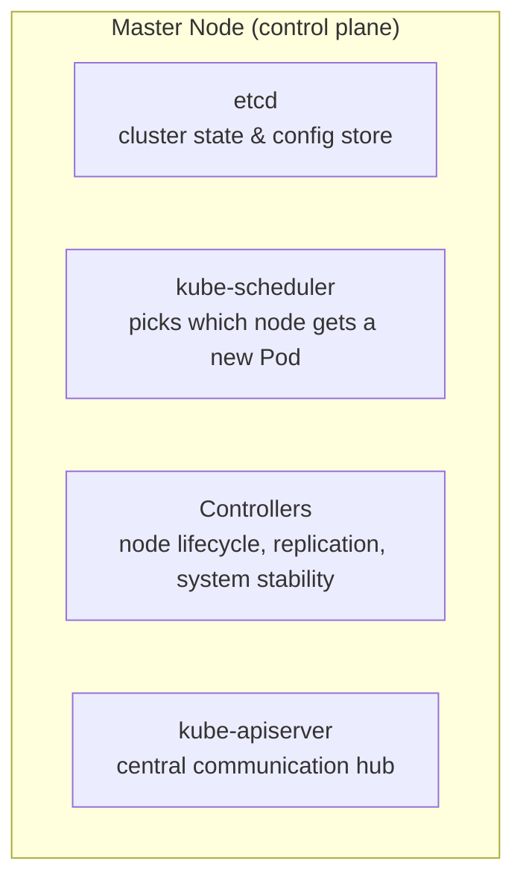
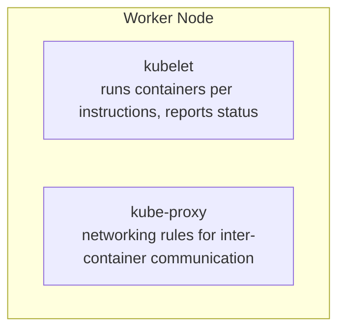

# 01 — Cluster Architecture (CKA)

*Digested from KodeKloud Notes, 2026-10-13: `notes.kodekloud.com/docs/Certified-Kubernetes-Administrator-CKA/Core-Concepts/Cluster-Architecture`. Restructured and paraphrased — not a transcript. Short, purely conceptual page (no commands) — heavy overlap with the Beginner course's [Lecture 02 — Kubernetes Architecture](../udemyBeginner/02-kubernetes-architecture.md); this note covers the same ground from the CKA exam's own framing, worth treating as a refresher pass rather than brand-new material.*

---

## Slide 1 — The Framing: Control Ships and Cargo Ships

- **Master node** ≈ a control ship — doesn't carry cargo itself, but tracks and directs the whole fleet.
- **Worker node** ≈ a cargo ship — actually carries the containers (the "cargo") and does the real work.
- A cluster is just a set of nodes (physical or virtual, on-prem or cloud) split across these two roles.

## Slide 2 — Master Node Components

- **etcd** — a highly-available key-value store holding the cluster's full state (every node and container tracked here). Uses a **quorum mechanism** for consistent, reliable storage across the cluster.
- **kube-scheduler** — decides which worker node should host a newly-created container, weighing current load, resource requirements, and placement constraints like **taints, tolerations, and node affinity rules**.
- **Controllers** (e.g. the replication controller) — keep the desired number of containers running and manage overall node operations, continuously reconciling actual state toward desired state.
- **kube-apiserver** — the central hub every other component and every external command goes through to communicate with and manage the cluster.

## Slide 3 — Worker Node Components

- **kubelet** — the node's own "captain": takes instructions from the `kube-apiserver` to create/update/delete containers, and continuously reports the node's status back.
- **kube-proxy** — configures the networking rules that let containers communicate across nodes (e.g. a web server on one node reaching a database on another).

## Slide 4 — The Container Runtime Requirement

- The entire control system is itself containerized — **every node, including master nodes**, needs a compatible container runtime (Docker, containerd, or CRI-O) to actually run these components.

## Slide 5 — Summary Table

| Component Category | Key Components | Role |
|---|---|---|
| **Master Node** | etcd, kube-scheduler, Controllers, kube-apiserver | Centralized control and management of the entire cluster. |
| **Worker Node** | kubelet, kube-proxy | Container lifecycle management + inter-service network communication. |

- The clear separation between these two roles — master coordinates, worker executes — is what lets Kubernetes automate and streamline container orchestration at scale.

---

## Key Terms

- **Master node** — hosts the control plane; coordinates the cluster but doesn't run application containers itself.
- **Worker node** — runs the actual application containers.
- **etcd** — the cluster's key-value store of state/configuration, using a quorum mechanism for consistency.
- **kube-scheduler** — decides which worker node a new container/Pod is placed on.
- **Controllers** — reconciliation loops keeping actual cluster state matching desired state (replica counts, node health, etc.).
- **kube-apiserver** — the single communication hub all other components and external `kubectl` commands go through.
- **kubelet** — the per-node agent that actually creates/manages containers and reports node status.
- **kube-proxy** — manages per-node networking rules enabling cross-node container communication.
