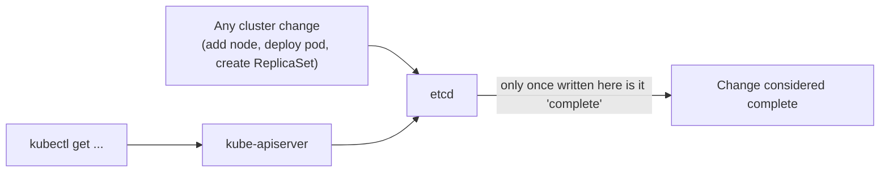
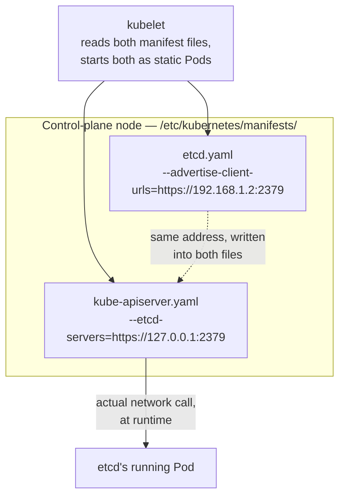

# 03 — ETCD in Kubernetes (CKA)

*Digested from Udemy CKA course lecture notes, 2026-10-14. Restructured, condensed, and paraphrased — not a transcript. Builds directly on [02 — ETCD For Beginners](02-etcd-for-beginners.md).*

---

## Slide 1 — etcd's Role in a Kubernetes Cluster



- **etcd stores all cluster state:** nodes, Pods, ConfigMaps, Secrets, service accounts, Roles, RoleBindings, and more.
- **Every `kubectl get` is really reading from etcd** (via the API server).
- **A change isn't actually "done" until etcd reflects it** — adding a node, deploying a Pod, creating a ReplicaSet, etc. all only count as complete once written to etcd.

## Slide 2 — Two Ways etcd Gets Deployed

- **From scratch (manual setup):** you download the etcd binaries yourself, install them, and configure etcd as a service on the master node directly — full manual control, including all the service's config options (most relate to TLS certificates, covered in a dedicated later section).
- **Via `kubeadm`:** `kubeadm` deploys etcd for you automatically, running it as a **Pod in the `kube-system` namespace**.
- Both approaches exist in practice — the course's own practice-test labs use `kubeadm`-provisioned clusters, while a later "from scratch" section builds one manually, specifically so the contrast between the two is clear.

## Slide 3 — The Advertised Client URL (How `kube-apiserver` Finds etcd)

**In one sentence: it's etcd's own address, and it's how `kube-apiserver` knows where to reach it.**

- etcd has many config options (most are TLS-certificate-related, covered in a dedicated later section) — out of all of them, **the advertised client URL specifically** is the one worth knowing cold right now.
- `kube-apiserver` is configured with this exact address (IP + port **2379** by default) as a startup flag, so it knows where to send every read/write.
- **Why it matters:** if this is wrong, or etcd is unreachable at that address, `kube-apiserver` can't read or write *any* cluster state — the entire cluster effectively stops working for anything.
- **Where to actually find it (kubeadm clusters — the realistic case):**

```bash
cat /etc/kubernetes/manifests/etcd.yaml   # on the control-plane node — shows the advertised
                                            # client URL, cert paths, and every other etcd flag
                                            # for this specific cluster, directly
```

**What it actually looks like, concretely — the flag is a real line in that file, not a dynamic/runtime value:**

```yaml
# /etc/kubernetes/manifests/etcd.yaml
spec:
  containers:
    - command:
        - etcd
        - --advertise-client-urls=https://192.168.1.2:2379
        - --listen-client-urls=https://127.0.0.1:2379,https://192.168.1.2:2379
```

```yaml
# /etc/kubernetes/manifests/kube-apiserver.yaml — the matching other half
spec:
  containers:
    - command:
        - kube-apiserver
        - --etcd-servers=https://127.0.0.1:2379
```

Two separate static Pod manifests, on the same control-plane node — `kubeadm` wrote the same address into both when the cluster was initialized. `kubelet` just reads each file and starts each container; it has no idea the two flags are related to each other — the *connection* only exists because the address matches.



This file is the concrete, actionable version of "know the advertised client URL" — rather than an abstract concept, it's a real file on a real node you'd open to confirm or troubleshoot it.

## Slide 4 — Exploring etcd's Data Directly

```bash
etcdctl get / --prefix --keys-only   # list all keys stored by Kubernetes (run inside the etcd pod/service)
```

- Kubernetes stores its data under a specific directory structure, rooted at `/registry` — underneath that: `minions`/`nodes`, `pods`, `replicasets`, `deployments`, and the rest of the Kubernetes object types.

## Slide 5 — A Preview of High Availability

- In an HA setup, there are **multiple master nodes**, and correspondingly **multiple etcd instances** — one per master node.
- These etcd instances need to know about each other — configured via the **`initial cluster`** option in etcd's service configuration, listing out the different etcd instances.
- (Full HA mechanics — distributed consensus, the Raft protocol, recommended cluster node counts — covered in a dedicated later section.)

---

## Key Terms

- **etcd's role in Kubernetes** — the single source of truth for all cluster state; every object Kubernetes manages is stored here, and no change is "complete" until it's reflected in etcd.
- **`kubeadm`-deployed etcd** — runs as a Pod in the `kube-system` namespace, set up automatically.
- **From-scratch etcd** — manually downloaded, installed, and configured as a service on the master node.
- **Advertised client URL** — etcd's own address (IP + port 2379); `kube-apiserver` is configured with this exact URL so it knows where to reach etcd. On a `kubeadm` cluster, visible directly in `/etc/kubernetes/manifests/etcd.yaml` on the control-plane node.
- **`/registry`** — the root directory under which Kubernetes stores all its object data inside etcd (nodes, Pods, ReplicaSets, Deployments, etc.).
- **`initial cluster` option** — in an HA setup, the etcd config setting that lists out the cluster's other etcd instances so they can discover each other.
