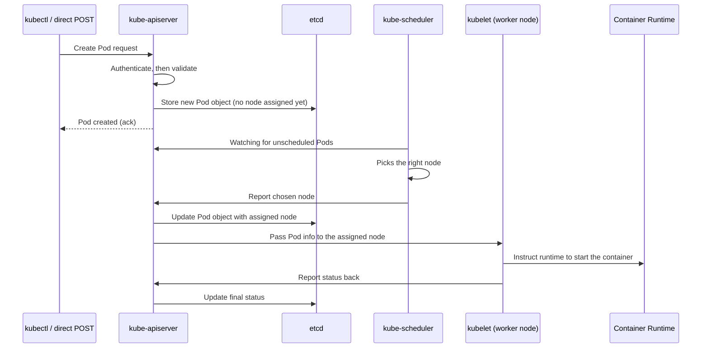

# 04 — Kube-apiserver (CKA)

*Digested from Udemy CKA course lecture notes, 2026-10-14. Restructured, condensed, and paraphrased — not a transcript. Confirms and extends what was already worked out about etcd connectivity in [03 — ETCD in Kubernetes](03-etcd-in-kubernetes.md).*

---

## Slide 1 — The Central Hub

- **`kube-apiserver` is the primary management component** — every request, from every source, goes through it.
- `kubectl` commands are really just `kube-apiserver` requests under the hood — but it's not the only way in: you can call the API directly yourself (e.g. a raw `POST` request to create a Pod), bypassing `kubectl` entirely.
- Every request follows the same first two steps regardless of source: **authenticate**, then **validate**.

## Slide 2 — Confirmed: `kube-apiserver` Is the *Only* Component That Talks to etcd Directly

- Every other component — scheduler, `kube-controller-manager`, `kubelet` — goes **through the API server** to read or update cluster state. None of them talk to etcd directly themselves.
- This confirms exactly what the previous lecture's advertised-client-URL discussion implied: `kube-apiserver` is etcd's one and only direct client within the cluster.

## Slide 3 — Full Request Flow: Creating a Pod



- **Note the Pod is created *before* any node is assigned** — the API server writes it to etcd immediately, unscheduled.
- The **scheduler** is the one watching for Pods with no node assigned — once it picks a node, it reports back to the API server (never writes to etcd itself).
- The **API server** is the only one actually writing to etcd, at every single step of this flow.
- **This exact same pattern repeats for every kind of cluster change** — not just Pod creation. `kube-apiserver` sits at the center of all of it.

## Slide 4 — Deployment: kubeadm vs. From Scratch

- **`kubeadm`:** deploys `kube-apiserver` automatically as a **static Pod in `kube-system`** — same pattern as etcd. You don't need to manually configure any of this.
- **From scratch:** `kube-apiserver` is downloaded as a binary from the Kubernetes release page and configured to run as a service on the master node, manually.
- `kube-apiserver` takes **many startup parameters** — a lot relate to certificates (securing connectivity between all the different components; covered in a dedicated TLS/SSL section later) and to telling each component where to find every other component.

## Slide 5 — The One Option Worth Knowing Now: `--etcd-servers`

- **`--etcd-servers`** is the flag specifying where `kube-apiserver` should find etcd — this is the exact flag confirmed in the previous lecture's manifest example (`--etcd-servers=https://127.0.0.1:2379`), matching etcd's own `--advertise-client-urls`.

## Slide 6 — Where to Actually Find These Options

```bash
# kubeadm-provisioned cluster:
cat /etc/kubernetes/manifests/kube-apiserver.yaml

# non-kubeadm (from-scratch) setup:
cat /etc/systemd/system/kube-apiserver.service

# either way, the running process and its effective options:
ps -ef | grep kube-apiserver
```

---

## Key Terms

- **`kube-apiserver`** — the central management component; every request (via `kubectl` or direct API calls) goes through it, and it's the *only* component that talks to etcd directly.
- **Request flow** — authenticate → validate → read/write via etcd → hand off to the relevant component (scheduler, kubelet) → that component reports back to the API server, which writes the result to etcd.
- **`--etcd-servers`** — the `kube-apiserver` startup flag specifying etcd's address; must match etcd's own `--advertise-client-urls`.
- **`/etc/kubernetes/manifests/kube-apiserver.yaml`** — where to find `kube-apiserver`'s config on a `kubeadm` cluster (static Pod manifest).
- **`/etc/systemd/system/kube-apiserver.service`** — where to find it on a from-scratch, non-`kubeadm` setup.
