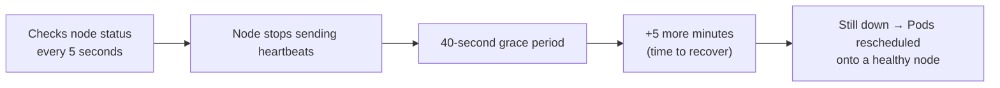

# 05 — Kube Controller Manager (CKA)

*Digested from KodeKloud Notes, 2026-10-14: `notes.kodekloud.com/docs/Certified-Kubernetes-Administrator-CKA/Core-Concepts/Kube-Controller-Manager`. Restructured and paraphrased — not a transcript.*

---

## Slide 1 — What Controllers Actually Do

- **A controller ≈ a department in an organization** — each one owns one specific responsibility, continuously watching for changes and driving the cluster toward its desired state.
- **Node Controller** — monitors node health.
- **Replication Controller** — ensures the specified number of Pods is always running, creating new ones as needed.
- Nearly every core Kubernetes construct (Deployments, Services, Namespaces, Persistent Volumes) relies on some controller underneath it — controllers are effectively the cluster's "brains."

## Slide 2 — Node Controller Mechanics (a concrete failure-detection timeline)



```bash
kubectl get nodes
NAME         STATUS   ROLES    AGE   VERSION
worker-1     Ready    <none>   8d    v1.13.0
worker-2     Ready    <none>   8d    v1.13.0

# after worker-2 fails to recover:
kubectl get nodes
NAME         STATUS     ROLES    AGE   VERSION
worker-1     Ready      <none>   8d    v1.13.0
worker-2     NotReady   <none>   8d    v1.13.0
```

- **The real timeline a failure actually takes:** 5s detection interval → 40s grace period → 5 more minutes before giving up → only then are that node's Pods rescheduled elsewhere. A node doesn't get marked unreachable or lose its Pods instantly.

## Slide 3 — All Controllers Bundled Into One Process

- Every individual controller is packaged into a single process: the **Kube Controller Manager**. Deploying it starts every controller together — one deployment, not dozens of separate processes to manage.
- Controllers can be selectively enabled/disabled via the `--controllers` flag — `foo` enables a named controller, `-foo` disables it, `*` enables all on-by-default ones:

```bash
--controllers=*,-tokencleaner   # all default controllers, except tokencleaner
```

(Full controller list includes: `attachdetach`, `cronjob`, `daemonset`, `deployment`, `job`, `namespace`, `nodeipam`, `nodelifecycle`, `replicaset`, `replicationcontroller`, `statefulset`, and many more — `bootstrapsigner` and `tokencleaner` are disabled by default.)

## Slide 4 — Installing and Configuring

```bash
wget https://storage.googleapis.com/kubernetes-release/release/v1.13.0/bin/linux/amd64/kube-controller-manager
```

```bash
# kube-controller-manager.service
ExecStart=/usr/local/bin/kube-controller-manager \
    --address=0.0.0.0 \
    --cluster-cidr=10.200.0.0/16 \
    --cluster-name=kubernetes \
    --cluster-signing-cert-file=/var/lib/kubernetes/ca.pem \
    --cluster-signing-key-file=/var/lib/kubernetes/ca-key.pem \
    --kubeconfig=/var/lib/kubernetes/kube-controller-manager.kubeconfig \
    --leader-elect=true \
    --root-ca-file=/var/lib/kubernetes/ca.pem \
    --service-account-private-key-file=/var/lib/kubernetes/service-account-key.pem \
    --service-cluster-ip-range=10.32.0.0/24 \
    --use-service-account-credentials=true \
    --v=2
Restart=on-failure
RestartSec=5
```

## Slide 5 — Viewing It in an Existing Cluster

```bash
# kubeadm cluster — runs as a static Pod; inspect its manifest directly:
cat /etc/kubernetes/manifests/kube-controller-manager.yaml

# either setup — check the running process and its effective flags:
ps -aux | grep kube-controller-manager
```

---

## Key Terms

- **Controller** — a background process watching for a specific kind of change and driving the cluster toward its desired state (e.g. Node Controller, Replication Controller).
- **Kube Controller Manager** — the single process that bundles every individual controller together; one deployment starts all of them.
- **`--controllers` flag** — enables/disables specific controllers (`foo` on, `-foo` off, `*` all-default-on).
- **Node failure timeline** — 5s check interval → 40s grace period → +5min before rescheduling that node's Pods elsewhere.
