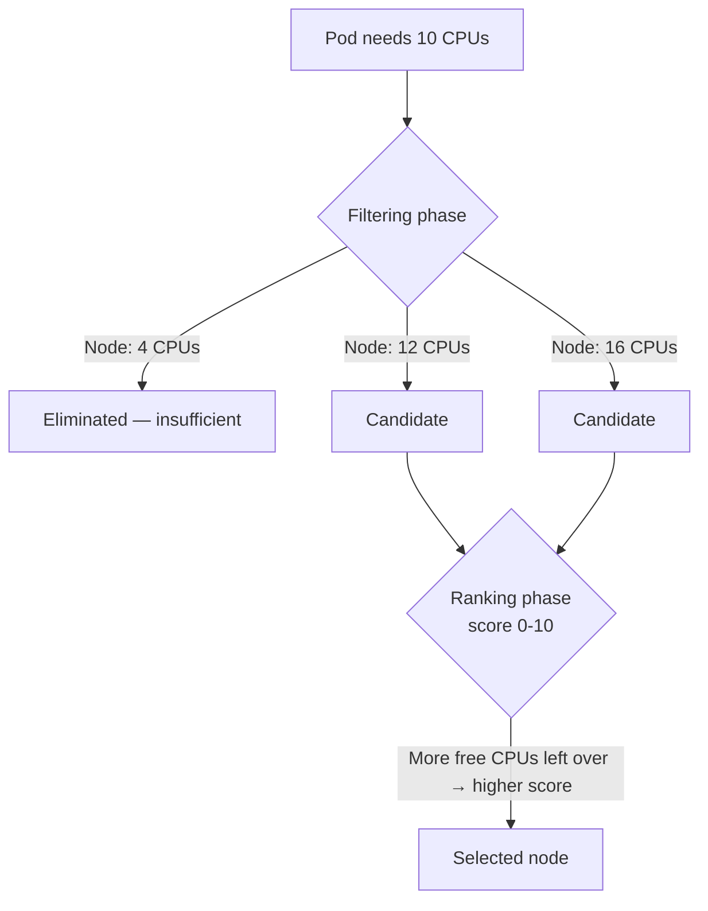

# 06 — Kube Scheduler (CKA)

*Digested from KodeKloud Notes, 2026-10-14: `notes.kodekloud.com/docs/Certified-Kubernetes-Administrator-CKA/Core-Concepts/Kube-Scheduler`. Restructured and paraphrased — not a transcript.*

---

## Slide 1 — What the Scheduler Actually Does (and Doesn't)

- **The scheduler only decides *which node* a Pod should go on** — it never actually creates the Pod itself. That's `kubelet`'s job, on whichever node gets picked.
- Decision is based on resource requirements and any specific placement constraints a Pod or node carries.

## Slide 2 — The Two-Phase Process: Filtering, Then Ranking



1. **Filtering** — immediately eliminate any node that doesn't meet the Pod's resource requirements (e.g. not enough CPU/memory).
2. **Ranking** — score the remaining candidates (0-10) using a priority function; e.g. a node left with *more* free CPU after placement scores higher than one left with less, and the highest-scoring node is picked.

- The scheduler is highly customizable — it's even possible to write and run your own custom scheduler if needed. More advanced scheduling levers (resource limits, taints/tolerations, node selectors, affinity rules) are covered separately.

## Slide 3 — Installing and Running

```bash
wget https://storage.googleapis.com/kubernetes-release/release/v1.13.0/bin/linux/amd64/kube-scheduler
```

```bash
# kube-scheduler.service
ExecStart=/usr/local/bin/kube-scheduler \
    --config=/etc/kubernetes/config/kube-scheduler.yaml \
    --v=2
```

## Slide 4 — Viewing It in an Existing Cluster

```bash
# kubeadm cluster — runs as a static Pod; inspect its manifest directly:
cat /etc/kubernetes/manifests/kube-scheduler.yaml

# either setup — check the running process and its effective flags:
ps -aux | grep kube-scheduler
```

---

## Key Terms

- **Kube Scheduler** — decides *which node* a new Pod should be placed on; never creates the Pod itself (that's `kubelet`'s job on the chosen node).
- **Filtering phase** — eliminates nodes that don't meet a Pod's resource requirements.
- **Ranking phase** — scores the remaining candidate nodes (0-10) via a priority function to pick the best match.
