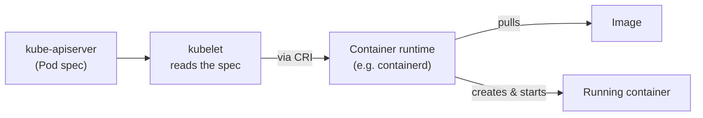

# 07 — Kubelet (CKA)

*Digested from KodeKloud Notes, 2026-10-14: `notes.kodekloud.com/docs/Certified-Kubernetes-Administrator-CKA/Core-Concepts/Kubelet`. Restructured and paraphrased — not a transcript.*

---

## Slide 1 — What Kubelet Does

- **Often called "the captain of the ship"** — meaning captain of the *node* specifically: there is exactly **one `kubelet` per node**, not one per Pod or per container. That single `kubelet` is responsible for *everything* running on its node — however many Pods get scheduled there, and however many containers are inside each.
- Its responsibilities: starting/stopping containers based on instructions from the scheduler, registering the node with the cluster, continuously monitoring Pod/container state, and reporting node + workload status back to `kube-apiserver`.

## Slide 2 — The Real Mechanism Chain (Pod Isn't an Active Link)

**A common mental-model trap:** it's tempting to think `kubelet` → talks to → the Pod → which talks to → the container. That's not quite right — a **Pod isn't an active process that relays anything**. A Pod is just a *spec*, a logical grouping ("these containers belong together") — it never itself communicates with anything.

The actual chain:



1. `kubelet` reads a Pod's spec (received via `kube-apiserver`).
2. `kubelet` instructs the **container runtime** (not the container itself) via the CRI.
3. The runtime pulls the image, then creates and starts a container from it.

So it's the **runtime** that does the real work (pull the image, instantiate the container) — not "the container creates and runs the image." The container is the *output* of that process.

## Slide 3 — The Hierarchy: Where Containment Actually Stops

**Node → Pod → Container is genuine containment** — each level really does host/hold the next (a Node hosts Pods, a Pod holds Containers).

**Container → Image is a different *kind* of relationship — not containment.** An Image isn't nested inside a Container; it's closer to **class vs. instance**. The Image is the static template; a Container is a *running instance created from* that Image — and one Image can produce many separate, independent Containers. The Image sits outside the containment hierarchy entirely, as the template Containers get instantiated from, not another layer underneath them.

## Slide 4 — Why `kubeadm` Doesn't Install Kubelet (a Chicken-and-Egg Problem)

- **Every other control-plane component gets deployed automatically by `kubeadm`** (etcd, `kube-apiserver`, scheduler, controller-manager — all as static Pods). **Kubelet is the one exception**, and it's not an oversight.
- Static Pods are themselves a **`kubelet` feature** — `kubelet` is what watches a manifest directory on disk and starts containers from it directly, with no API server involved at all. That means `kubeadm` can't bootstrap *anything* — not even the control plane on the master node — without `kubelet` already running there first.
- Same story on worker nodes: `kubeadm join` configures an **already-installed** `kubelet` to connect to the cluster; it doesn't install `kubelet` itself.
- **The real answer: `kubelet` has to exist first, everywhere, master included — it's the mechanism that makes `kubeadm`'s whole static-Pod bootstrapping method possible in the first place.**

## Slide 5 — What Happens With No Kubelet at All

Two genuinely different failure shapes, depending on which node:

- **Missing on a worker node:** that machine never registers with the cluster (registration is `kubelet`'s job) — it simply **doesn't exist as a node** from Kubernetes' perspective. Nothing can be scheduled there; `kube-apiserver` has no channel to reach it. The API server itself is fine — this one machine just can't be reached.
- **Missing on the master node:** more severe — since `kube-apiserver` (and etcd, scheduler, controller-manager) are static Pods that `kubelet` is responsible for launching, **none of them ever start running at all.** It's not "can't talk to `kube-apiserver`" — there's no `kube-apiserver` process in existence to talk to in the first place.

## Slide 6 — Installing Kubelet

```bash
wget https://storage.googleapis.com/kubernetes-release/release/v1.13.0/bin/linux/amd64/kubelet
```

```bash
ExecStart=/usr/local/bin/kubelet \
    --config=/var/lib/kubelet/kubelet-config.yaml \
    --container-runtime=remote \
    --container-runtime-endpoint=unix:///var/run/containerd/containerd.sock \
    --image-pull-progress-deadline=2m \
    --kubeconfig=/var/lib/kubelet/kubeconfig \
    --network-plugin=cni \
    --register-node=true \
    --v=2
```

- Note `--container-runtime-endpoint` — the exact CRI socket path `kubelet` talks to (here, containerd's), confirming the CRI mechanism covered back in the Beginner course's Docker-vs-containerd lecture.

## Slide 7 — Verifying It's Running

```bash
ps -aux | grep kubelet
```

---

## Key Terms

- **Kubelet** — the per-node agent (exactly one per node) that manages every Pod/container on that node, registers the node, and reports status back to `kube-apiserver`; talks to the container runtime (not the container directly) to actually start/stop containers.
- **Pod (as kubelet sees it)** — a spec/grouping, not an active communicating layer — `kubelet` reads it and acts, the Pod itself never relays anything.
- **Image vs. Container** — class vs. instance, not containment. An Image is the static template; a Container is a running instance created from it, sitting outside the Node → Pod → Container containment hierarchy.
- **The one real exception to `kubeadm` automation** — unlike every other control-plane component, `kubelet` is never auto-installed by `kubeadm`, because it's the mechanism (via static Pods) that makes `kubeadm`'s own bootstrapping possible in the first place; it must already exist, manually installed, before `kubeadm` can do anything, on every node including the master.
- **No `kubelet` on a worker node** → that node is simply unreachable/unregistered. **No `kubelet` on the master node** → the control plane (etcd, `kube-apiserver`, etc.) never starts at all, since those are themselves static Pods `kubelet` launches.
- **`--container-runtime-endpoint`** — the CRI socket path `kubelet` is configured to talk to (e.g. containerd's socket).
