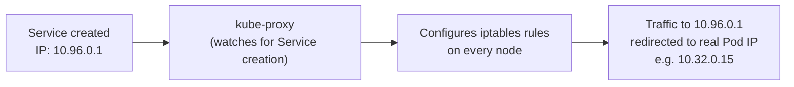
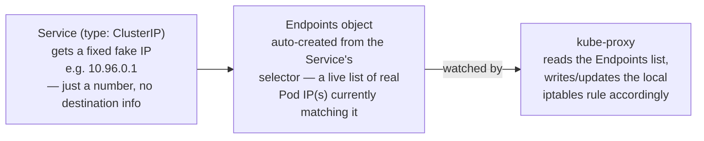

# 08 — Kube Proxy (CKA)

*Digested from KodeKloud Notes, 2026-10-14: `notes.kodekloud.com/docs/Certified-Kubernetes-Administrator-CKA/Core-Concepts/Kube-Proxy`. Restructured and paraphrased — not a transcript. Confirms and extends the Beginner course's own [Basics of Networking](../udemyBeginner/10-basics-of-networking.md) and [Services](../udemyBeginner/11-services-nodeport.md) lectures.*

---

## Slide 1 — The Pod Network (What Makes Pod-to-Pod Reachability Possible at All)

- **New detail from the transcript, not previously in this file:** every Pod being able to reach every other Pod isn't automatic — it's provided by deploying a **pod networking solution** to the cluster (a CNI plugin). This creates an internal virtual network spanning all nodes, which every Pod connects to.
- With that network in place, one Pod *can* reach another directly by IP — e.g. a web app Pod on node 1 reaching a database Pod on node 2 purely via the DB Pod's IP.
- **The catch: there's no guarantee a Pod's IP stays the same** — if it's recreated (crash, reschedule), it gets a new one. That's the actual problem a Service exists to solve, layered on top of the pod network, not a replacement for it.

## Slide 2 — The Problem It Solves (Recap + Confirmation)

- **A Service fixes the IP-instability problem** — a stable, named endpoint (e.g. `DB`) that the web app can always reach, regardless of which actual Pod IP is backing it at any given moment.
- **Confirmed detail:** a Service is a genuinely virtual entity — it doesn't correspond to any real container or network interface, and it does **not** join the pod network the way a Pod does, precisely because it isn't an actual running thing. It only exists as a persistent record the cluster tracks in memory, providing a stable access point to whatever real Pods happen to back it.

## Slide 3 — How Kube Proxy Actually Works



- `kube-proxy` is a lightweight process running on **every node** in the cluster.
- Its job: watch for Service creation, and configure network rules (commonly **iptables rules**) that redirect traffic sent to a Service's IP toward the actual backing Pod's IP.
- This redirection works transparently cluster-wide — regardless of which node a request actually originates from.

## Slide 4 — The Full Mapping Chain: ClusterIP → Endpoints → Kube-Proxy

*Extended Q&A discussion, 2026-10-14 — captures where the mental model kept slipping and how it got corrected.*

The ClusterIP itself carries zero destination information — it's just a number. The actual real-Pod-IP mapping is assembled from three separate pieces:



1. **Creating a Service** (default `type: ClusterIP`) gets it a fixed, fake IP from a reserved range (e.g. `10.96.0.0/12` — a visibly different range than real Pod IPs). This IP is permanent for the Service's lifetime but is not attached to anything real.
2. The Service's `selector` causes Kubernetes to auto-create a companion **Endpoints object** — a continuously-updated list of the real Pod IP(s) currently matching that selector. When a backend Pod is recreated with a new IP, a controller (bundled inside `kube-controller-manager`) updates this list automatically.
3. **`kube-proxy` is the process that reads the Endpoints list** and writes the corresponding local iptables rule on every node: *"packet to `10.96.0.1`? rewrite destination to whatever real Pod IP is currently in the Endpoints list."*

**Key corrections surfaced during this discussion:**
- `kube-proxy` is **not** itself "an IP table" or a Service — it's the running process that *writes and maintains* the iptables rule. The rule is the artifact; `kube-proxy` is the worker producing it.
- `kube-proxy` runs on **every node**, not just worker nodes — the DaemonSet covers the control-plane node(s) too (any node could host the frontend Pod trying to reach a ClusterIP).
- The real destination of a rewritten packet is always a **Pod IP**, never a Node IP — a node can host many Pods; "which node" is irrelevant to the actual routing decision.

## Slide 5 — Why Not Just Send Directly to the Real Pod IP?

Two separate reasons this breaks down, both resolved by ClusterIP + kube-proxy:

1. **Staleness:** a hardcoded real Pod IP works right up until that Pod restarts (crash, reschedule) and comes back with a *different* real IP — hardcoded callers have no way to know, and silently start failing until manually fixed.
2. **Multiple replicas:** once there's more than one backend Pod, "send directly to Pod X" doesn't even have one right answer anymore. `kube-proxy`'s rewrite rule also load-balances (commonly round-robin) across every real Pod IP currently in the Endpoints list — the caller sends to one fixed address and transparently lands on whichever replica is next in rotation.

## Slide 6 — Decision vs. Delivery (the Two-Layer Split)

The cleanest way to keep the pod network and kube-proxy from blurring together: **one decides, the other delivers.**

- **Pod network (CNI) = delivery layer.** Purely about getting a packet from any real IP to any real IP, across nodes. It has zero awareness that Services, ClusterIPs, or kube-proxy even exist — by the time it handles a packet, any rewriting has already happened.
- **`kube-proxy` = decision layer.** Intercepts a packet addressed to a ClusterIP *before* it ever reaches the pod network, and rewrites its destination to a real Pod IP.

**Full trace, start to finish:** frontend Pod sends a packet to the ClusterIP (`10.96.0.1`) → on its own node, `kube-proxy`'s local iptables rule rewrites the destination to the current real backend Pod IP (`10.32.0.22`) → *only now* does the pod network take over, routing this already-rewritten, perfectly ordinary-looking packet to the real Pod, completely unaware any rewriting occurred.

## Slide 7 — Installing Kube Proxy

- Manual path: download the binary from the Kubernetes release page, extract, run as a service.
- **Via `kubeadm`: deployed automatically as a `DaemonSet`** — guaranteeing exactly one `kube-proxy` Pod runs on every node in the cluster, with no manual per-node setup needed. (A dedicated DaemonSet lecture is still ahead in the course — not needed to understand this point, just worth knowing the term is covered in full later.)

## Slide 8 — Verifying the Deployment

```bash
kubectl get pods -n kube-system
kubectl get daemonset -n kube-system
```

---

## Key Terms

- **Pod network** — the internal virtual network, spanning every node, that a pod networking solution (CNI plugin) provides — this is what makes direct Pod-to-Pod IP reachability possible at all, before Services even enter the picture. Purely a "delivery" layer — gets a packet from any real IP to any real IP, with zero awareness that Services or kube-proxy exist.
- **ClusterIP** — the default Service type; also the name for the fake, fixed IP a Service gets (e.g. `10.96.0.1`), pulled from a reserved range distinct from real Pod IPs. Carries no destination information by itself — just a stable, permanent number.
- **Endpoints object** — auto-created from a Service's `selector`; a live list of the real Pod IP(s) currently matching it, kept up to date by a controller whenever backing Pods are recreated.
- **Kube Proxy** — a process (not a table, not a Service) running on **every node** (including control-plane nodes, not just workers). Watches Services + their Endpoints objects and writes/maintains the local iptables rules that rewrite ClusterIP-addressed traffic to the current real Pod IP — the "decision" layer, as opposed to the pod network's "delivery" layer. Also load-balances (round-robin) across multiple real Pod IPs behind one Service.
- **Service (confirmed)** — a virtual entity with no real container/interface of its own, and does **not** join the pod network — just a stable, persistent endpoint the cluster tracks in memory, routing to whichever real Pods currently back it.
- **Why not just use the real Pod IP directly** — two reasons: (1) staleness — a hardcoded real IP breaks the moment that Pod restarts and gets a new one; (2) no single right answer once there are multiple replicas — kube-proxy's rewrite also handles load-balancing across all of them.
- **DaemonSet deployment (via `kubeadm`)** — `kube-proxy` is deployed this way automatically, guaranteeing one instance per node.
