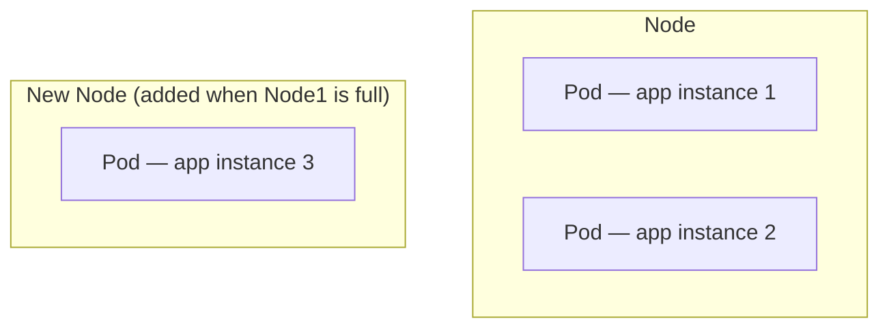
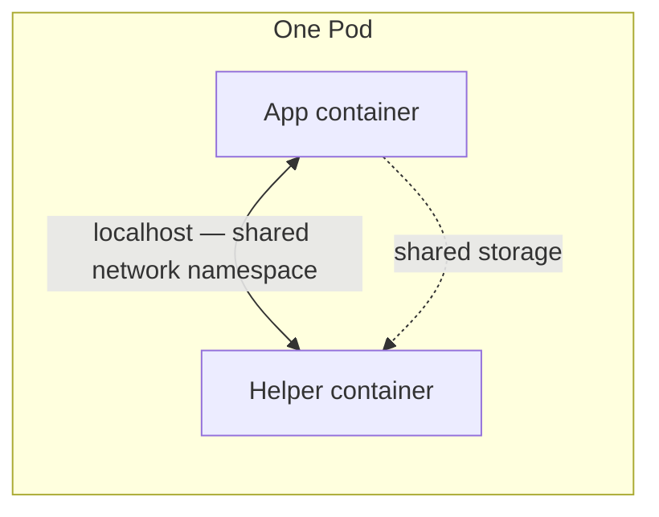

# 09 — Pods (CKA)

*Source: Beginner course Lecture 04 + cross-referenced 2026-10-14 against the CKA notes site's own "Pods" page (`notes.kodekloud.com/docs/Certified-Kubernetes-Administrator-CKA/Core-Concepts/Pods`) — confirmed no real differences, content merged into one authoritative version here.*

---

## Slide 1 — What is a Pod?

- **Kubernetes never deploys containers directly onto a node.** Every container gets wrapped inside a Kubernetes object called a **Pod**.
- A **Pod** is the **smallest deployable unit** in Kubernetes.
- In the simplest case: one Pod wraps exactly one container, running one instance of the app.
- **Prerequisites this lecture assumes:** the app is already built into a Docker image and published somewhere Kubernetes can pull it from (e.g. Docker Hub), and a cluster (single- or multi-node, doesn't matter which) is already up and running.

## Slide 2 — Scaling: One Pod per Instance



- To handle more load, you **never** add more containers into an existing Pod.
- Instead: **scale up** by creating entirely new Pods, each a fresh instance of the same app. **Scale down** by deleting Pods.
- If a node runs out of capacity, add another node to the cluster and spread new Pods onto it.
- **The takeaway: Pods and containers usually have a 1-to-1 relationship** when the goal is scaling. Load balancing *across* those Pods is a separate concept, covered later.

## Slide 3 — Multi-Container Pods (the exception, not the rule)



- A single Pod **can** hold multiple containers — but typically not multiple copies of the *same* container (that's what separate Pods are for).
- **The real use case:** a "helper" container doing supporting work for the main app (e.g. processing uploaded data) that needs to live and die *alongside* the app container specifically.
- Containers sharing a Pod share:
  - **Lifecycle** — created together, destroyed together.
  - **Network namespace** — can reach each other directly via `localhost`.
  - **Storage** — can share volumes directly.

## Slide 4 — Why Kubernetes Requires Pods at All (even for one container)

Without this abstraction, manually running a paired app + helper container setup on raw Docker means handling, yourself:

- Networking between the two containers (manual links/custom networks).
- Shared volumes, and keeping track of which containers share which.
- Lifecycle monitoring — manually killing the helper when the app dies, and redeploying both together on every new instance.

**Kubernetes automates all of this** once containers are declared as part of the same Pod — shared network, shared storage, and shared lifecycle come for free.

**This is why Kubernetes mandates the Pod wrapper even for a single-container app** — it future-proofs the app for architectural complexity later, without a redesign. That said: **multi-container Pods are explicitly called a rare case** — most real-world Pods stick to one container per Pod.

## Slide 5 — Deploying and Inspecting Pods

```bash
kubectl run <pod-name> --image=<image-name>   # creates a Pod, deploys the given image into it
kubectl get pods                               # lists pods and their current status
```

- `kubectl run` actually creates a **Pod** under the hood and deploys the specified container image into it.
- `--image` tells Kubernetes which image to pull — from a public registry (Docker Hub) or a private one, depending on configuration.
- `kubectl get pods` shows each Pod's status (e.g. `ContainerCreating` → `Running`).
- **Not covered yet:** making the Pod reachable from *outside* the node — that's a separate topic (Services/networking), already covered in the Beginner course's own lectures 10-13.

---

## Key Terms

- **Pod** — the smallest deployable unit in Kubernetes; a wrapper around one or more containers.
- **1-to-1 Pod-to-container relationship** — the default scaling model: new instance = new Pod, not a new container in an existing Pod.
- **Multi-container Pod** — a Pod holding more than one container (typically an app + a helper), sharing network namespace, storage, and lifecycle. A rare pattern in practice.
- **`kubectl run`** — creates a Pod and deploys a specified image into it.
- **`kubectl get pods`** — lists Pods and their status.
