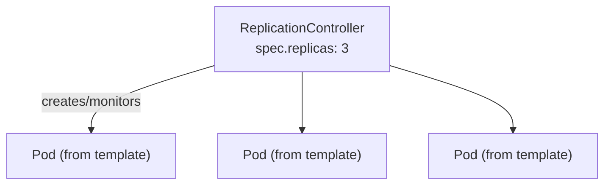
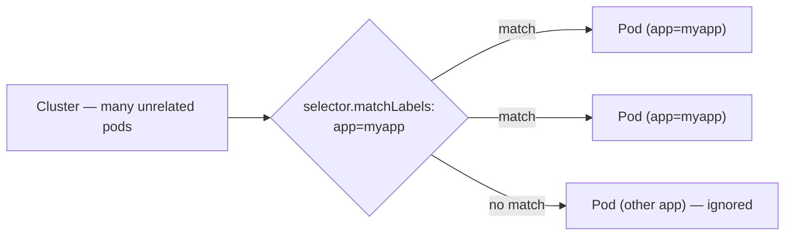

# 10 — Replication Controllers and ReplicaSets (CKA)

*Source: Beginner course Lecture 07, merged with the CKA notes site's own "ReplicaSets" page (`notes.kodekloud.com/docs/Certified-Kubernetes-Administrator-CKA/Core-Concepts/ReplicaSets` — this single page covers both Replication Controllers and ReplicaSets together). Cross-referenced 2026-10-14; one real difference folded in below (`replace` vs. `apply`).*

---

## Slide 1 — Why a Replication Controller Exists

- **Controllers are Kubernetes' "brain"** — background processes that continuously watch objects and react to keep reality matching the desired state.
- **High availability:** if a single pod is the only instance and it crashes, users lose access. A Replication Controller (RC) keeps a specified number of pod instances running at all times — even a count of 1. If that one pod dies, the RC brings up a replacement automatically.
- **Load distribution:** as demand grows, the RC can run multiple pod instances to spread load — across the same node, and once a node runs out of capacity, across other nodes in the cluster too.
- An RC/ReplicaSet is **cluster-wide**, not tied to a single node — it spans nodes to both balance load and provide failover.

## Slide 2 — ReplicationController vs. ReplicaSet

- Same core purpose, different technologies: **ReplicationController is the older mechanism**; **ReplicaSet is the newer, recommended replacement.**
- Everything about *why* you'd use one applies equally to both — the differences are mechanical (covered below), not conceptual.
- Going forward, **ReplicaSet is the one actually used** in practice — ReplicationController is covered mainly for historical/legacy context.

## Slide 3 — Creating a ReplicationController

```yaml
apiVersion: v1
kind: ReplicationController
metadata:
  name: myapp-rc
  labels:
    app: myapp
    type: front-end
spec:
  template:
    metadata:
      name: myapp-pod
      labels:
        app: myapp
    spec:
      containers:
        - name: nginx-container
          image: nginx
  replicas: 3
```

- `apiVersion: v1` for ReplicationController.
- `spec.template` holds the **full pod definition** the RC uses to create replicas — effectively a Pod definition file's `metadata` + `spec`, nested one level deeper, minus its own top-level `apiVersion`/`kind` (those two lines are dropped; everything else moves under `template`).
- `spec.replicas` sets the desired count. `template` and `replicas` are **siblings** — same indentation, both direct children of `spec`.
- Result: this file ends up with **two `metadata` sections and two `spec` sections** — one pair for the RC itself, one pair (nested inside `template`) for the pod it creates. The RC is the parent definition; the pod definition is nested as its child.



```bash
kubectl create -f rc-definition.yaml
kubectl get replicationcontroller   # shows desired / current / ready counts
kubectl get pods                    # created pods are named myapp-rc-<suffix>
```

## Slide 4 — Creating a ReplicaSet

```yaml
apiVersion: apps/v1
kind: ReplicaSet
metadata:
  name: myapp-replicaset
  labels:
    app: myapp
    type: front-end
spec:
  template:
    metadata:
      name: myapp-pod
      labels:
        app: myapp
    spec:
      containers:
        - name: nginx-container
          image: nginx
  replicas: 3
  selector:
    matchLabels:
      app: myapp
```

- **`apiVersion` changes to `apps/v1`** (not `v1`) — using `v1` here produces an error (`no matches for kind "ReplicaSet"`), since `v1` doesn't support this kind.
- Structurally near-identical to a ReplicationController: same `template` + `replicas` pattern.
- **The one required addition: `selector`**, written as `matchLabels`. This is the real mechanical difference between the two technologies.

## Slide 5 — Why `selector` Is Required (Labels & Selectors)

- A ReplicaSet doesn't only create new pods from its template — it can also **adopt and monitor pre-existing pods** that already match its selector's labels, even if those pods weren't created by this ReplicaSet at all.
- `selector.matchLabels` is how the ReplicaSet decides **which pods in the cluster are "mine" to watch** — critical in a cluster that may have hundreds of unrelated pods running other applications.
- **ReplicationController:** `selector` is optional — if omitted, it defaults to the labels already given in the pod template.
- **ReplicaSet:** `selector` (as `matchLabels`) is **required**, and supports richer matching options beyond simple label equality that ReplicationController never had.
- Even if matching pods already exist and the ReplicaSet creates zero new ones on deployment, **`template` is still required** — it's needed later, the moment an existing pod fails and a replacement has to be created.



## Slide 6 — Scaling a ReplicaSet

Two ways to go from 3 replicas to 6:

```bash
# Option 1: edit replicas in the YAML file, then update the live object
kubectl replace -f replicaset-definition.yaml

# Option 2: scale directly from the command line
kubectl scale --replicas=6 -f replicaset-definition.yaml
# or, by name instead of file:
kubectl scale --replicas=6 replicaset myapp-replicaset
```

- **Option 1** keeps the YAML file itself as the source of truth — the file's `replicas` value is updated to match reality. **`kubectl replace -f`** fully overwrites the live object with what's in the file (as opposed to `kubectl apply -f`, which does a smart merge/patch instead) — both work for this simple case, but they're not strictly interchangeable, and `replace` is the one CKA material reaches for first.
- **Option 2** (`kubectl scale`) changes the live cluster state immediately, but **does not update the YAML file** — the file still says `replicas: 3` even though the cluster now runs 6. Worth tracking manually to avoid drift between the file and reality.
- Load-based auto-scaling exists but is a separate, more advanced topic.

## Slide 7 — Command Reference

```bash
kubectl create -f <file>.yaml                     # create a ReplicaSet (or any object) from a file
kubectl get replicaset                             # list ReplicaSets
kubectl get pods                                   # list pods it created/adopted
kubectl delete replicaset <name>                   # delete a ReplicaSet
kubectl replace -f <file>.yaml                      # replace/update from a file
kubectl scale --replicas=<n> -f <file>.yaml         # scale without editing the file
```

---

## Key Terms

- **Controller** — a background Kubernetes process that watches objects and reconciles actual state toward desired state.
- **ReplicationController (RC)** — the older mechanism for keeping a specified number of pod replicas running; `apiVersion: v1`.
- **ReplicaSet** — the newer, recommended replacement for RC; `apiVersion: apps/v1`; requires an explicit `selector`.
- **`spec.template`** — the nested pod definition (its own `metadata` + `spec`) a RC/ReplicaSet uses to create new replicas.
- **`spec.replicas`** — the desired pod count; a sibling of `template` under `spec`.
- **`spec.selector.matchLabels`** — defines which pods (new or pre-existing) the ReplicaSet considers its own to monitor; optional (defaults to template labels) for RC, required for ReplicaSet.
- **`kubectl replace -f`** — fully overwrites a live object from a YAML file (vs. `kubectl apply -f`, a smart merge/patch) — the one CKA material favors.
- **`kubectl scale`** — scales a running RC/ReplicaSet from the command line without editing its YAML file (causes file/cluster drift if not also updated manually).
