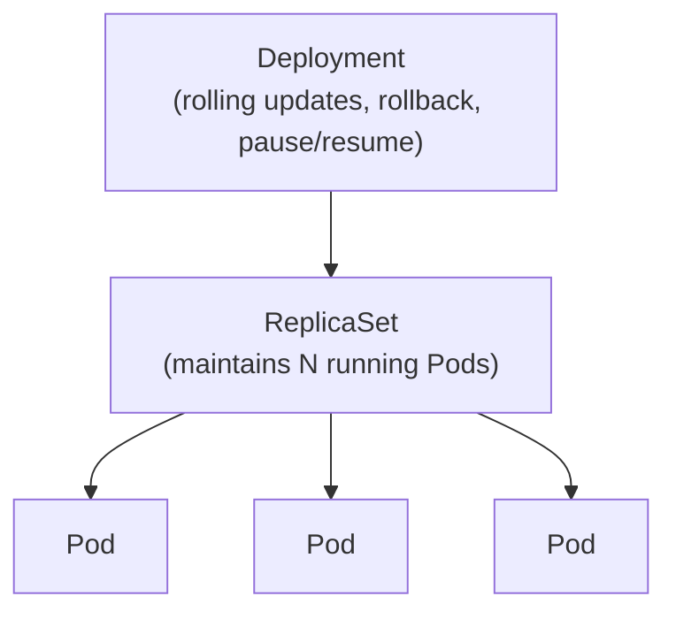
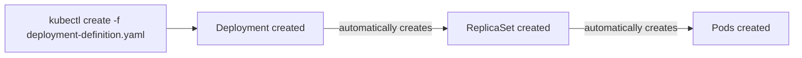

# 11 — Deployments (CKA)

*Source: Beginner course Lecture 08, merged with the CKA notes site's own "Deployments" page (`notes.kodekloud.com/docs/Certified-Kubernetes-Administrator-CKA/Core-Concepts/Deployments`). Cross-referenced 2026-10-14.*

---

## Slide 1 — Why Deployments Exist (Production Use Cases)

Setting aside Pods/ReplicaSets for a moment — a real production deployment needs more than just "run N instances":

- **Multiple instances** running simultaneously, for the obvious availability/load reasons already covered.
- **Seamless upgrades** when a newer image build becomes available — but **not all instances at once**, since that would disrupt users mid-upgrade. Upgrading instances one at a time instead is called a **rolling update**.
- **Rollback** — if an upgrade causes an unexpected error, the ability to undo the most recent change and return to the prior working state.
- **Pause and resume** — when making several related changes at once (e.g. upgrading the image version, scaling replica count, adjusting resource allocations), apply them all as a batch and roll them out together, rather than triggering a separate rollout after every individual command.

**All of these capabilities come from a Deployment** — none of them exist at the Pod or ReplicaSet level alone.

## Slide 2 — Where Deployment Sits in the Hierarchy



- **Pod** — deploys a single instance of the application.
- **ReplicaSet** (or the older ReplicationController) — maintains multiple Pod instances.
- **Deployment** — sits a level above ReplicaSet, adding the upgrade/rollback/pause-resume capabilities on top.

## Slide 3 — Creating a Deployment

```yaml
apiVersion: apps/v1
kind: Deployment
metadata:
  name: myapp-deployment
  labels:
    app: myapp
spec:
  template:
    metadata:
      name: myapp-pod
      labels:
        app: myapp
    spec:
      containers:
        - name: nginx-container
          image: nginx
  replicas: 3
  selector:
    matchLabels:
      app: myapp
```

- **A Deployment's definition file is structurally identical to a ReplicaSet's** — same `apiVersion: apps/v1`, same `template`/`replicas`/`selector` shape under `spec` — the **only difference is `kind: Deployment`** instead of `kind: ReplicaSet`.

```bash
kubectl create -f deployment-definition.yaml
kubectl get deployments
```

## Slide 4 — What Actually Gets Created Underneath



- Creating a Deployment **automatically creates a ReplicaSet** underneath it — visible via `kubectl get replicaset`, named after the Deployment.
- That ReplicaSet, in turn, **creates the Pods** — visible via `kubectl get pods`, named using both the Deployment's and ReplicaSet's names.
- **At this point, a Deployment and a ReplicaSet look nearly identical in behavior** — the real difference (rolling updates, rollback, pause/resume) is the Deployment object itself existing as a distinct, addressable thing.

## Slide 5 — Inspecting Everything at Once

```bash
kubectl get all
```

A concrete worked example of what this actually looks like:

```console
NAME                            DESIRED   CURRENT   UP-TO-DATE   AVAILABLE   AGE
deploy/myapp-deployment         3         3         3            3           9h

NAME                                        DESIRED   CURRENT   READY   AGE
rs/myapp-deployment-6795844b58              3         3         3       9h

NAME                                       READY   STATUS    RESTARTS   AGE
po/myapp-deployment-6795844b58-5rbjl        1/1     Running   0          9h
po/myapp-deployment-6795844b58-h4w55        1/1     Running   0          9h
po/myapp-deployment-6795844b58-1fjhv        1/1     Running   0          9h
```

Note the naming chain, concretely: the ReplicaSet's name is the Deployment's name plus a hash (`-6795844b58`), and each Pod's name is the ReplicaSet's full name plus its own short suffix — makes it easy to trace any Pod back to its ReplicaSet and Deployment just by reading the name.

---

## Key Terms

- **Deployment** — a Kubernetes object one level above ReplicaSet; adds rolling updates, rollback, and pause/resume on top of ReplicaSet's "maintain N Pods" behavior.
- **Rolling update** — upgrading running instances one at a time rather than all simultaneously, to avoid disrupting users mid-upgrade.
- **Rollback** — undoing a recent change (e.g. a bad upgrade) back to the prior working state.
- **Pause/resume** — batching multiple changes (image version, replica count, resource allocation, etc.) so they roll out together in one pass, instead of one rollout per command.
- **`kubectl get all`** — lists every created object (Deployments, ReplicaSets, Pods, etc.) in a single view; naming chain traces Pod → ReplicaSet → Deployment.
