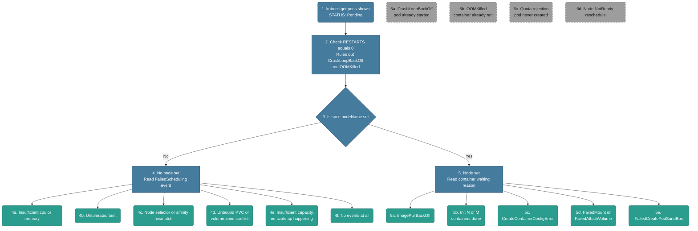

# Troubleshooting: Pending Pods

*Built 2026-10-25 via `/troubleshootingk8s`. Signal-driven, not a memorized cause list — every branch below is triggered by something you'd actually observe. Diagram node numbers match the Written Walkthrough's numbered steps below.*

## Diagram (plain text — no renderer needed)

```text
Pod STATUS: Pending
│
├─ 1-2. Check RESTARTS = 0
│       RUN: kubectl get pods
│       Rules out CrashLoopBackOff (6a) and OOMKilled (6b) —
│       neither has ever started
│
└─ 3. Is spec.nodeName set?
      RUN: kubectl get pod <name> -o jsonpath='{.spec.nodeName}'
      (or: kubectl describe pod <name>  →  check the "Node:" line)
      │
      ├─ NO  → 4. Read the FailedScheduling event
      │         RUN: kubectl describe pod <name>   (see Events)
      │         ├─ 4a. Insufficient cpu or memory
      │         │       RUN: kubectl describe node <node> | grep -A5 Allocated
      │         ├─ 4b. Untolerated taint
      │         │       RUN: kubectl describe node <node> | grep Taints
      │         ├─ 4c. Node selector or affinity mismatch
      │         │       RUN: kubectl get nodes --show-labels
      │         ├─ 4d. Unbound PVC or volume zone conflict
      │         │       RUN: kubectl describe pvc <name>
      │         ├─ 4e. Insufficient capacity, no scale-up happening
      │         │       RUN: kubectl logs -n kube-system deployment/cluster-autoscaler
      │         └─ 4f. No events at all (silence)
      │                 RUN: kubectl get pod <name> -o jsonpath='{.spec.schedulerName}{"\n"}{.spec.schedulingGates}'
      │
      └─ YES → 5. Read the container's waiting reason
                RUN: kubectl describe pod <name>   (see Containers > State)
                ├─ 5a. ImagePullBackOff
                │       RUN: kubectl describe pod <name>   (read the Events message)
                ├─ 5b. Init:N/M
                │       RUN: kubectl logs <pod> -c <init-container-name>
                ├─ 5c. CreateContainerConfigError
                │       RUN: kubectl describe pod <name>   (Events name the missing key)
                ├─ 5d. FailedMount or FailedAttachVolume
                │       RUN: kubectl get volumeattachment
                └─ 5e. FailedCreatePodSandBox
                        RUN: kubectl get nodes -o wide   (check pod CIDR usage)

Off-path (looks related, already ruled out at step 1-2):
  6a. CrashLoopBackOff   - pod already started and exited
  6b. OOMKilled          - container already ran, then killed
  6c. Quota rejection    - pod object never created at all
  6d. Node NotReady      - a reschedule, not a fresh scheduling issue
```

## Diagram (Mermaid — optional, skip this if it doesn't render for you; the text tree above and the walkthrough below have the same information)



*(Off-path nodes 6a-6d are deliberately drawn with no connecting arrows — they're not reachable from the main flow, since they describe states that look related but are already ruled out by step 2.)*

## Written Walkthrough (the actual train of thought, not just facts)

*This is written as the internal monologue you'd narrate live — the questions you'd ask yourself, in order, not a reference list. Step numbers match the diagram.*

### Steps 1-2 — First Glance

- **What I run:** `kubectl get pods`
  ```
  NAME    READY   STATUS    RESTARTS   AGE
  myapp   0/1     Pending   0          2m
  ```
- **What Pending actually means:** the pod hasn't gotten to the point of actually running a container yet — nothing's executing.
- **What I check first:** RESTARTS, right there in that same table. It's 0 — and that's meaningful, not just a number I glance past. A restart can only happen after a container has started and then exited at least once.
- **What that already rules out:** if RESTARTS is 0, nothing has run, period — so this isn't CrashLoopBackOff and isn't OOMKilled (6a/6b), both of which need a container to have started first.
- **Where that leaves me:** whatever's wrong is happening *before or during* the container trying to start, not after.

### Step 3 — The Fork

- **The real question:** why would a pod never even get to the point of starting a container?
- **Two broad explanations:** either it was never assigned a node to run on at all, or it was assigned a node and something on that specific node is blocking it from starting.
- **Why the split matters:** these are two completely different problems, owned by two completely different parts of the system — one's the scheduler's responsibility, the other's the kubelet's. The scheduler's job ends the instant it writes a node's name into the pod.
- **What I run:** `kubectl describe pod myapp` and look at the `Node:` line (or `kubectl get pod myapp -o jsonpath='{.spec.nodeName}'` for just the raw value)
  ```
  Not yet scheduled:          Node:    <none>
  Already scheduled:          Node:    node-3/10.0.1.42
  ```
- **The fastest way to split it:** that one line tells me which half of the system to go investigate, before I waste time reading the wrong logs.

### Step 4 — No Node Set (now thinking entirely about the scheduler)

- **Why no node got picked:** the scheduler's job is to find a node that satisfies every constraint on this pod — if it came up empty, *something* about this pod's requirements didn't fit anywhere.
- **What I run:** `kubectl describe pod myapp` and read the Events section at the bottom
  ```
  Events:
    Type     Reason            Age   From               Message
    ----     ------            ----  ----               -------
    Warning  FailedScheduling  60s   default-scheduler   0/3 nodes are available: 3 Insufficient cpu.
  ```
- **What I check next:** the actual FailedScheduling event — the scheduler tells me, in plain text, which constraint it couldn't satisfy. (The Message text above is just one example — 4a through 4f below are the different things it might actually say.)

**4a. Insufficient cpu or memory**
- First thought: the cluster's just full, or this pod's asking for more than it actually needs.
- If the cluster's otherwise healthy and just busy, it's probably genuinely out of room.
- Before jumping to "add more nodes," check whether this pod's requests were ever actually right — that's the cheaper fix if they're padded.
- **What the message looks like:**
  ```
  Warning  FailedScheduling  60s  default-scheduler  0/3 nodes are available: 3 Insufficient cpu, 3 Insufficient memory.
  ```
- **Fix:** lower the pod's requests, or add capacity. Tradeoff: lowering requests risks eviction if they weren't actually padded; adding nodes costs money.

**4b. Untolerated taint**
- Different kind of thought entirely: a taint means someone *deliberately* fenced off certain nodes on purpose.
- Next question: are there dedicated node pools in this cluster, and is this just a general workload missing the matching toleration? That's almost always it.
- **What the message looks like:**
  ```
  Warning  FailedScheduling  60s  default-scheduler  0/3 nodes are available: 3 node(s) had untolerated taint {dedicated: gpu-only}.
  ```
- **Fix:** add a matching toleration to the pod, or remove the taint. Tradeoff: a broad toleration can let the pod land somewhere the taint was meant to protect it from.

**4c. Node selector or affinity mismatch**
- Now thinking about labels, not capacity: did this pod require something specific — a GPU, a zone, an instance type — and do the nodes that exist right now actually carry that label?
- This is the kind of thing that breaks right after someone changes a node pool.
- **What the message looks like:**
  ```
  Warning  FailedScheduling  60s  default-scheduler  0/3 nodes are available: 3 node(s) didn't match Pod's node affinity/selector.
  ```
- **Fix:** label the right nodes, or relax the affinity rule. Tradeoff: relaxing it loses the locality/hardware guarantee the affinity existed for in the first place.

**4d. Unbound PVC or volume zone conflict**
- Trickier — slow down here. Not really a pure scheduling problem: storage made a placement decision before the scheduler did.
- The volume is already bound to a PV that lives in one zone (because the StorageClass binds `Immediate`, or the PV was pre-provisioned), and no node that fits the pod's other constraints exists in that zone. The scheduler has to put the pod where the disk is — and it can't.
- `WaitForFirstConsumer` is the usual *fix*, not the cause: it delays provisioning until the scheduler picks a node, so the disk gets created in the right zone.
- If this pod uses a PVC and the cluster spans zones, this is probably it — easy to misread as plain capacity if the message isn't read carefully.
- **What the message looks like:**
  ```
  Warning  FailedScheduling  60s  default-scheduler  0/3 nodes are available: 3 node(s) had volume node affinity conflict.
  ```
  (or, if the PVC was never bound at all rather than zone-mismatched: `pod has unbound immediate PersistentVolumeClaims`)
- **Fix:** provision a PV in the right zone, or fix the StorageClass's topology constraints. Tradeoff: zone-pinning limits where the pod can ever run, hurting availability during a zone outage.

**4e. Insufficient capacity, no scale-up**
- If the same Insufficient cpu/memory message persists and I'd expect the cluster to scale up and it isn't, the problem has moved past the scheduler entirely.
- The autoscaler is a separate system that can fail quietly on its own — wrong node group, already at max size, hit a cloud quota.
- Only check autoscaler logs after confirming the scheduler's complaint genuinely isn't resolving on its own.
- **What the message looks like:** the same 4a message, just repeating over time with no new node ever appearing:
  ```
  Warning  FailedScheduling  5m (x12 over 5m)  default-scheduler  0/3 nodes are available: 3 Insufficient cpu.
  ```
  The repetition is the actual signal here, not different wording.
- **Fix:** fix the autoscaler config or raise its max size, or add a node manually. Tradeoff: manual nodes aren't self-healing; raising max size raises the cost ceiling.

**4f. No events at all**
- The one that actually makes me pause the most, because silence is itself information.
- If the scheduler had tried and failed, it would've told me why. No events at all usually means it never even tried.
- Check whether `schedulerName` is pointing at something that isn't actually running, or `schedulingGates` are still sitting on this pod, deliberately holding it out of the queue.
- **What it looks like:**
  ```
  Events:  <none>
  ```
- **Fix:** fix or remove the custom `schedulerName`, or clear whatever's holding the `schedulingGate`. Tradeoff: gates are sometimes intentional — confirm nothing external is supposed to clear it first.

### Step 5 — Node Set (now thinking about the kubelet)

- **What changes:** the scheduler already succeeded, so the question becomes: this pod has a home, so why hasn't its container actually started yet?
- **What I run:** `kubectl get pods` again — the STATUS column itself usually already names the waiting reason directly
  ```
  NAME    READY   STATUS             RESTARTS   AGE
  myapp   0/1     ImagePullBackOff   0          3m
  ```
  (or `kubectl describe pod myapp` → Containers → State: Waiting, for the same thing plus the full event message)
- **What I check next:** that waiting reason — tells me exactly where kubelet got stuck. (ImagePullBackOff shown above is just one example — 5a through 5e below are the different things it might actually say.)

**5a. ImagePullBackOff**
- First instinct, honestly, before anything else — it's just the most common one in practice.
- Can kubelet actually get this image? Wrong tag, bad credentials, registry down — the actual error message in the event will usually tell me which one immediately.
- **What the message looks like:**
  ```
  NAME    READY   STATUS             RESTARTS   AGE
  myapp   0/1     ImagePullBackOff   0          3m

  Events:
    Warning  Failed   kubelet  Failed to pull image "myapp:v2": rpc error: code = NotFound desc = failed to pull and unpack image: not found
    Warning  BackOff  kubelet  Back-off pulling image "myapp:v2"
  ```
- **Fix:** fix the tag or registry auth (`imagePullSecrets`), or the registry's own availability. Tradeoff: pinning to a verified tag improves reliability but loses auto-updates from a floating tag.

**5b. Init:N/M**
- Makes me think about ordering: init containers run one at a time, in sequence, and nothing else starts until they're done.
- If this pod has init containers at all, I go straight to that specific init container's logs, not the main container's.
- **What the message looks like:**
  ```
  NAME    READY   STATUS     RESTARTS   AGE
  myapp   0/1     Init:1/2   0          1m
  ```
- **Fix:** fix whatever that specific init container depends on. Tradeoff: adding retry/backoff logic inside the init container is more resilient but slows every pod start down.

**5c. CreateContainerConfigError**
- Tells me kubelet didn't even get as far as asking the runtime to do anything — something it needed (a ConfigMap key, a Secret) doesn't exist.
- Ask what else got deployed around the same time — a mismatched config rollout is almost always the cause.
- **What the message looks like:**
  ```
  NAME    READY   STATUS                       RESTARTS   AGE
  myapp   0/1     CreateContainerConfigError   0          30s

  Events:
    Warning  Failed  kubelet  Error: couldn't find key API_KEY in ConfigMap default/myapp-config
  ```
- **Fix:** create the missing ConfigMap/Secret key, or fix the reference. No real tradeoff — this is a straightforward misconfiguration.

**5d. FailedMount or FailedAttachVolume**
- Now thinking about the storage layer specifically: did the volume actually attach to this node, and did it actually mount into the pod? Two separate steps, either can fail on its own.
- If the node is new or just rebooted, suspect a stale attachment left over from wherever this volume lived before.
- **What the message looks like:**
  ```
  NAME    READY   STATUS              RESTARTS   AGE
  myapp   0/1     ContainerCreating   0          2m

  Events:
    Warning  FailedAttachVolume  2m   attachdetach-controller  AttachVolume.Attach failed for volume "pvc-abc123"
    Warning  FailedMount         30s  kubelet                  Unable to attach or mount volumes: timed out waiting for the condition
  ```
- **Fix:** fix the storage backend, credentials, or CSI driver health. Tradeoff: built-in retry costs time before failing over; manual intervention is faster but not self-healing.

**5e. FailedCreatePodSandBox**
- About networking, before the container even exists — the runtime asked the CNI plugin to set up a network namespace and that failed.
- First thought: has this node simply run out of pod IPs to hand out, especially if it's already running a lot of pods?
- **What the message looks like:**
  ```
  NAME    READY   STATUS              RESTARTS   AGE
  myapp   0/1     ContainerCreating   0          20s

  Events:
    Warning  FailedCreatePodSandBox  10s  kubelet  Failed to create pod sandbox: plugin type="calico" failed: no IP addresses available in range
  ```
- **Fix:** fix the CNI config, or free up/resize the node's pod IP range. Tradeoff: resizing CIDR ranges is disruptive and may need a cluster-level networking change.

### Step 6 — Off-Path: Sanity-Check Before Committing

- Walking an interviewer through the wrong category is worse than walking them through the right one slowly, so I'd check myself here first.

**6a. CrashLoopBackOff** — requires the container to have already started; already ruled out back at step 2.
**6b. OOMKilled** — same category, also requires the container to have already started and run.
**6c. Quota rejection** — wouldn't even leave me a pod to inspect; the object gets rejected before it's ever created. With a bare pod, `kubectl apply` errors right away. With a Deployment, `apply` *succeeds* — the ReplicaSet is what gets rejected, so the symptom is "fewer pods than expected" and the error lives in `kubectl describe rs <name>` as a `FailedCreate` event.
**6d. Node NotReady reschedule** — if this pod was running fine before and only just went Pending with no spec change, suspect the node, not the pod — a NotReady node evicts and reschedules, which looks exactly like a fresh scheduling failure but isn't one.

## Signal Table

| # | Signal | Why it points here | Confirm command | Fix / tradeoff |
|---|---|---|---|---|
| 4a | **Insufficient cpu/memory** (FailedScheduling) | Scheduler filters out every node without enough free allocatable capacity to satisfy the pod's requests | `kubectl describe node <node>` (Allocated resources) or `kubectl top nodes` | Lower requests or add capacity (autoscaler/manual node). Tradeoff: lowering requests risks eviction under real load; adding nodes costs money. |
| 4b | **Untolerated taint** (FailedScheduling) | Taints are an explicit node-side repel mechanism — scheduler filters out any node whose taint has no matching pod toleration | `kubectl describe node <node> \| grep Taints` vs. pod's `tolerations` | Add a matching toleration, or remove the taint. Tradeoff: a broad toleration can let the pod land somewhere the taint was meant to protect it from. |
| 4c | **Node selector/affinity mismatch** (FailedScheduling) | nodeSelector/nodeAffinity are hard scheduler filters — no node currently carries the required label(s) | `kubectl get nodes --show-labels` vs. pod's `.spec.affinity` | Label the right nodes, or relax the affinity rule. Tradeoff: relaxing it loses the locality/hardware guarantee the affinity existed for. |
| 4d | **Unbound PVC / volume zone conflict** (FailedScheduling) | The PVC is already bound to a zonal PV (`Immediate` binding or pre-provisioned), and no node that fits the pod's other constraints is in that zone — or the PVC isn't bound at all |  `kubectl describe pvc <name>`, `kubectl get pv -o wide` | Provision a PV in the right zone, or fix StorageClass topology. Tradeoff: zone-pinning limits where the pod can ever run, hurting availability during a zone outage. |
| 4e | **Insufficient capacity, no scale-up** | Cluster-autoscaler is a separate controller outside the core scheduler loop — if it's misconfigured, scaling the wrong node group, or already at max size, no new capacity appears no matter how long you wait | `kubectl logs -n kube-system deployment/cluster-autoscaler`, check node group max size | Fix autoscaler config or raise max size, or add a node manually. Tradeoff: manual nodes aren't self-healing; raising max size raises the cost ceiling. |
| 4f | **No events at all** | A pod with zero events after a real wait usually means the default scheduler never even picked it up — a custom `schedulerName` pointing nowhere, or a `schedulingGate` still present | `kubectl get pod <name> -o jsonpath='{.spec.schedulerName}{"\n"}{.spec.schedulingGates}'` | Fix/remove the custom scheduler name, or clear the scheduling gate. Tradeoff: gates are sometimes intentional — confirm nothing external is supposed to clear it first. |
| 5a | **ImagePullBackOff** | Kubelet delegates image retrieval to the container runtime; backoff means repeated pulls have failed and it's now waiting between retries | `kubectl describe pod <name>` (read the Events message directly — it carries the registry's real error) | Fix the tag/registry auth (`imagePullSecrets`) or registry availability. Tradeoff: pinning to a verified tag improves reliability but loses auto-updates from a floating tag. |
| 5b | **Init:N/M** | Kubelet runs init containers strictly in sequence before any main container starts — a stuck/failing init container blocks everything after it, and the pod stays Pending for the whole init phase | `kubectl logs <pod> -c <init-container-name>` | Fix what the init container depends on. Tradeoff: adding retry/backoff logic inside the init container is more resilient but slows every pod start down. |
| 5c | **CreateContainerConfigError** | Kubelet resolves ConfigMap/Secret references at container-creation time, before the runtime is even invoked — a missing key or object fails this resolution outright | `kubectl describe pod <name>` (Events usually name the missing key/object directly) | Create the missing ConfigMap/Secret key, or fix the reference. No real tradeoff — this is a straightforward misconfiguration. |
| 5d | **FailedMount / FailedAttachVolume** | This is the CSI/attach-detach-controller boundary — the volume has to attach to the node first (controller/CSI), then mount into the pod (kubelet/CSI node plugin); either step failing blocks the container | `kubectl describe pod <name>` for the event, then `kubectl get volumeattachment` and CSI driver pod logs on that node | Fix the storage backend, credentials, or CSI driver health. Tradeoff: built-in retry costs time before failing over; manual intervention is faster but not self-healing. |
| 5e | **FailedCreatePodSandBox** | Before any container runs, the runtime asks the CNI plugin to set up the pod's network namespace — a CNI error or exhausted pod-IP pool on that node means the sandbox never comes up | `kubectl describe pod <name>` for the event, then check CNI plugin logs/config and `kubectl get nodes -o wide` for pod CIDR usage | Fix CNI config, or free up/resize the node's pod IP range. Tradeoff: resizing CIDR ranges is disruptive and may need a cluster-level networking change. |

## What You'd Actually See (example output per signal)

*Realistic `kubectl` output for each cause — so you recognize the literal text, not just the concept. Numbers match every other section.*

### Scheduler-side (step 4) — all show STATUS: Pending with no node assigned; the Events block is what tells them apart

**4a. Insufficient cpu/memory**
```
Events:
  Warning  FailedScheduling  60s  default-scheduler  0/3 nodes are available: 3 Insufficient cpu, 3 Insufficient memory.
```

**4b. Untolerated taint**
```
Events:
  Warning  FailedScheduling  60s  default-scheduler  0/3 nodes are available: 3 node(s) had untolerated taint {dedicated: gpu-only}.
```

**4c. Node selector/affinity mismatch**
```
Events:
  Warning  FailedScheduling  60s  default-scheduler  0/3 nodes are available: 3 node(s) didn't match Pod's node affinity/selector.
```

**4d. Unbound PVC/volume zone conflict**
```
Events:
  Warning  FailedScheduling  60s  default-scheduler  0/3 nodes are available: 3 node(s) had volume node affinity conflict.
```
(or, if the PVC itself was never bound at all, rather than zone-mismatched: `pod has unbound immediate PersistentVolumeClaims`)

**4e. Insufficient capacity, no scale-up**
```
Events:
  Warning  FailedScheduling  5m (x12 over 5m)  default-scheduler  0/3 nodes are available: 3 Insufficient cpu.
```
Same message as 4a — the signal here isn't the text, it's that it keeps repeating over time with no new node ever showing up in `kubectl get nodes`.

**4f. No events at all**
```
Events:  <none>
```

### Kubelet-side (step 5) — these change the STATUS column itself, since the pod already has a node

**5a. ImagePullBackOff**
```
NAME    READY   STATUS             RESTARTS   AGE
myapp   0/1     ImagePullBackOff   0          3m

Events:
  Warning  Failed   kubelet  Failed to pull image "myapp:v2": rpc error: code = NotFound desc = failed to pull and unpack image: not found
  Warning  BackOff  kubelet  Back-off pulling image "myapp:v2"
```

**5b. Init:N/M**
```
NAME    READY   STATUS     RESTARTS   AGE
myapp   0/1     Init:1/2   0          1m
```

**5c. CreateContainerConfigError**
```
NAME    READY   STATUS                       RESTARTS   AGE
myapp   0/1     CreateContainerConfigError   0          30s

Events:
  Warning  Failed  kubelet  Error: couldn't find key API_KEY in ConfigMap default/myapp-config
```

**5d. FailedMount/FailedAttachVolume**
```
NAME    READY   STATUS              RESTARTS   AGE
myapp   0/1     ContainerCreating   0          2m

Events:
  Warning  FailedAttachVolume  2m   attachdetach-controller  AttachVolume.Attach failed for volume "pvc-abc123"
  Warning  FailedMount         30s  kubelet                  Unable to attach or mount volumes: timed out waiting for the condition
```

**5e. FailedCreatePodSandBox**
```
NAME    READY   STATUS              RESTARTS   AGE
myapp   0/1     ContainerCreating   0          20s

Events:
  Warning  FailedCreatePodSandBox  10s  kubelet  Failed to create pod sandbox: plugin type="calico" failed: no IP addresses available in range
```

### Off-path (step 6) — what you'd see if it's NOT actually a Pending problem

**6a. CrashLoopBackOff**
```
NAME    READY   STATUS             RESTARTS      AGE
myapp   0/1     CrashLoopBackOff   5 (90s ago)   4m
```
STATUS and RESTARTS both already show this is past "Pending" — it already ran.

**6b. OOMKilled**
```
NAME    READY   STATUS             RESTARTS   AGE
myapp   0/1     CrashLoopBackOff   3          3m

Last State:   Terminated
  Reason:     OOMKilled
  Exit Code:  137
```
Note the STATUS column still just says CrashLoopBackOff — OOMKilled is the *reason* one layer down, in "Last State," never the STATUS column itself.

**6c. Quota rejection**
```
$ kubectl apply -f pod.yaml
Error from server (Forbidden): pods "myapp" is forbidden: exceeded quota: compute-quota,
requested: requests.cpu=2, used: requests.cpu=9, limited: requests.cpu=10
```
There's no pod to `kubectl get` at all — the rejection happens at `apply`/`create` time, before a pod object ever exists.

**6d. Node NotReady reschedule**
```
$ kubectl get nodes
NAME     STATUS     ROLES    AGE   VERSION
node-1   NotReady   <none>   10d   v1.28.2

$ kubectl get pods
NAME    READY   STATUS    RESTARTS   AGE
myapp   0/1     Pending   0          15s
```
The new pod just looks like a fresh, ordinary Pending — check node health first if this pod was healthy minutes ago with no spec change.

## How to Say It Out Loud (interview script)

1. **Data first (steps 1-2):** "`kubectl get pods` shows STATUS Pending with zero restarts, so nothing's actually run yet — this is either a scheduling problem or an early kubelet-side problem, not a crash or an OOM kill."
2. **State the fork (step 3):** "The first thing I check is whether `spec.nodeName` is set, because that's the exact line between 'the scheduler hasn't placed this pod yet' and 'the scheduler succeeded, now it's kubelet or the node.'"
3. **One observation, then one check (step 4a):** "If nodeName's empty, I read the FailedScheduling event — say it's Insufficient memory — and confirm it against `kubectl describe nodes` to see actual allocatable versus what's already requested."
4. **Fix plus tradeoff:** "The fix is lowering the pod's requests or adding capacity; lowering requests risks eviction under real load, so I'd only do that if I'm confident the original request was padded, not actually needed."
5. **Prevention:** "Going forward I'd set requests based on observed usage instead of a guess, and alert on scheduler-queue depth so this surfaces before someone notices a stuck pod."

## Validation notes

*Checked 2026-10-25 against current Kubernetes behavior. The fork and the branches above hold up; these sharpen a few leaves.*

- **4f, scheduling gates:** on Kubernetes 1.27+, a gated pod doesn't just show `Pending` — `kubectl get pods` shows `STATUS: SchedulingGated`. Silence plus that status is a gate; silence with plain `Pending` points at `schedulerName` or the scheduler itself (file 03).
- **4e, autoscaler:** you don't always need the autoscaler's logs first — cluster-autoscaler writes events onto the pod itself (`NotTriggerScaleUp: pod didn't trigger scale-up: ... max node group size reached`). Read the pod's events before going to the logs.
- **5a:** `ErrImagePull` comes first, then `ImagePullBackOff` once retries start backing off. Same cause, different moment.
- **5b:** a failing init container shows `Init:Error` or `Init:CrashLoopBackOff`; a hanging one stays `Init:N/M`. Hanging usually means it's waiting on a dependency (a DB, a Service) that isn't up.
- **5d:** the classic message after a node dies or a pod moves is `Multi-Attach error for volume ... Volume is already exclusively attached to one node` — a `ReadWriteOnce` volume still held by the old node.
- **6d:** the pod isn't literally "rescheduled." The NotReady node gets tainted, its pods are evicted after ~5 minutes (`tolerationSeconds: 300`), and the ReplicaSet creates a *new* pod — that new pod is the one sitting in Pending.
