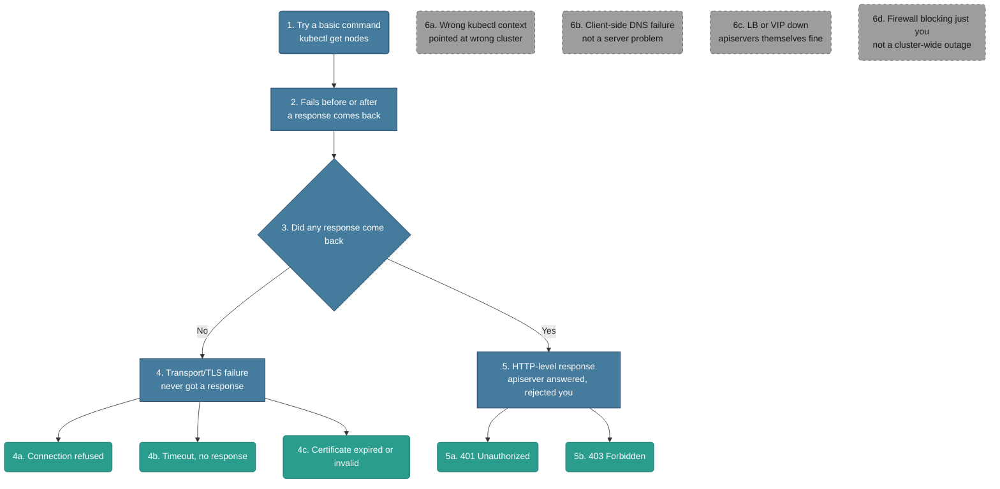

# Troubleshooting: apiserver Unreachable

*Built 2026-10-25 via `/troubleshootingk8s`. apiserver is the one component everything else depends on — if this is down, nothing else is even diagnosable through kubectl, which is why it gets its own file instead of being bundled with scheduler/controller-manager/etcd.*

## Diagram (plain text — no renderer needed)

```text
kubectl doesn't respond, or responds with an error
│
├─ 1-2. Try a basic command
│       RUN: kubectl get nodes
│       Does it fail before or after a response comes back?
│
└─ 3. Did a response come back at all (even a rejection)?
      │
      ├─ NO  → 4. Transport/TLS-level failure - never even got a response
      │         ├─ 4a. Connection refused
      │         ├─ 4b. Timeout, no response at all
      │         └─ 4c. Certificate expired or invalid (TLS handshake itself fails)
      │
      └─ YES → 5. HTTP-level response - apiserver answered, just rejected you
                ├─ 5a. 401 Unauthorized
                └─ 5b. 403 Forbidden

Off-path (looks like apiserver is down, but isn't):
  6a. Wrong kubectl context    - pointed at the wrong/dead cluster entirely, user error
  6b. Client-side DNS failure  - can't resolve the apiserver hostname locally, not a server problem
  6c. LB/VIP down, apiservers fine - HA setups: the load balancer in front is down, not the apiservers behind it
  6d. Firewall blocking just you - a cluster-wide outage looks identical to "only my IP is blocked"
```

## Diagram (Mermaid — optional, skip this if it doesn't render for you; the text tree above and the walkthrough below have the same information)



## Written Walkthrough (the actual train of thought, not just facts)

### Steps 1-2 — First Glance

- **What I run:** `kubectl get nodes` — any basic read command works, it's not about what I'm asking for.
- **What I'm actually watching for:** not just "did it work," but *where* it failed — before a response ever comes back, or after one does (even a rejection).
- **Why that distinction matters:** it's the fastest way to separate "the server is unreachable" from "the server is fine and is actively telling me no."

### Step 3 — The Fork

- **The real question:** did any response come back at all — including an error response?
- **Why this split matters:** a transport-level failure (no response) points at the process, the network path, or TLS — none of which involve apiserver's own logic running correctly. An HTTP-level response (even a 401/403) proves apiserver is healthy enough to parse the request and make an authorization decision — so I stop suspecting its health entirely and shift to suspecting *my* credentials instead.
- **What I run:** the same `kubectl get nodes` — I'm reading the shape of the failure, not running a different command.

### Step 4 — No Response At All (transport/TLS-level)

- **Why this happens:** the process isn't listening, something's blocking the network path to it, or the TLS handshake itself can't complete.

**4a. Connection refused**
- First thought: the host is reachable, but nothing is listening on that port — the kernel answered with a TCP reset. (A firewall `REJECT` rule can do the same, but a dead apiserver process is far more common.) A listening process would have accepted the connection, so "refused" points at the process, not the network.
- Since `kubectl` is useless here, I go to the control-plane node itself: `crictl ps -a | grep apiserver` and `crictl logs <id>`, plus `journalctl -u kubelet` to see why kubelet isn't keeping the static pod up. One common upstream cause: apiserver exits on startup because it can't reach etcd — so check its logs for etcd errors before assuming apiserver itself is the broken piece (file 04).
- If it's a kubeadm-style static pod setup, my first suspicion is the static manifest — moving or breaking `/etc/kubernetes/manifests/kube-apiserver.yaml` makes the process disappear, since kubelet only watches that exact path.
- **What the message looks like:**
  ```
  $ kubectl get nodes
  The connection to the server 10.0.1.10:6443 was refused - did you specify the right host or port?
  ```
- **Fix:** restart the apiserver process/static pod, confirm the manifest is present and valid. Tradeoff: edit static manifests via atomic replace, not in-place, to avoid a self-inflicted outage window.

**4b. Timeout, no response at all**
- Different from refused — refused means something answered "no" immediately; a timeout means nothing answered *at all*, which points more at network path (firewall, security group, routing) than the process itself.
- **What the message looks like:**
  ```
  $ kubectl get nodes
  Unable to connect to the server: dial tcp 10.0.1.10:6443: i/o timeout
  ```
- **Fix:** check the network path — firewall rules, security groups, routing between where you are and the control-plane node. Tradeoff: none major, just slower to isolate than a refused connection since there's no immediate error to read.

**4c. Certificate expired or invalid**
- A third, distinct category: something did respond enough to start a TLS handshake, but the handshake itself failed — so this is neither "nothing's listening" nor "network's blocked," it's specifically the cert layer.
- Certs have a hard expiry — this is the classic "cluster's been running exactly one year" surprise.
- **What the message looks like:**
  ```
  $ kubectl get nodes
  Unable to connect to the server: x509: certificate has expired or is not yet valid
  ```
- **Fix:** confirm with `kubeadm certs check-expiration`, then `kubeadm certs renew all`, then restart the control-plane static pods (they only load certs at startup), then copy the refreshed `/etc/kubernetes/admin.conf` into your kubeconfig. On kubeadm the CA lasts 10 years and `renew` doesn't touch it — only the 1-year leaf certs signed by it. Tradeoff: replacing the CA itself is a much bigger operation — every cert it signed and every kubeconfig that trusts it has to change too, or you lock yourself out.
- **Close cousin:** `x509: certificate signed by unknown authority` is not an expiry — your kubeconfig trusts a different CA than the one that signed the server's cert (wrong kubeconfig, or the cluster was rebuilt).

### Step 5 — A Response Came Back (apiserver is healthy, it's rejecting me specifically)

- **What changes:** I stop suspecting apiserver's health completely — it clearly parsed my request and made a decision. Now it's about identity and permissions.

**5a. 401 Unauthorized**
- apiserver doesn't know who I am — it couldn't even establish an identity from what I sent.
- **What the message looks like:**
  ```
  $ kubectl get nodes
  error: You must be logged in to the server (Unauthorized)
  ```
- **Fix:** fix the kubeconfig credentials — expired token, wrong/missing client cert. No real tradeoff.

**5b. 403 Forbidden**
- apiserver knows exactly who I am, it's telling me I'm not allowed to do this specific thing.
- **What the message looks like:**
  ```
  $ kubectl get nodes
  Error from server (Forbidden): nodes is forbidden: User "jdoe" cannot list resource "nodes" in API group "" at the cluster scope
  ```
- **Fix:** grant or correct the RBAC binding for this identity. Tradeoff: confirm which principal (user vs. ServiceAccount) actually needs the fix before changing bindings — too broad a grant is its own risk.

### Step 6 — Off-Path: Sanity-Check Before Committing

**6a. Wrong kubectl context** — pointed at a different, possibly dead, cluster entirely (`kubectl config current-context` / `kubectl config get-contexts`). A user-error lookalike, not an actual apiserver failure.
**6b. Client-side DNS failure** — can't resolve the apiserver's hostname locally; looks identical to connection refused/timeout from where you're sitting, but it's your resolver, not the server.
**6c. LB/VIP down, apiservers themselves fine** — in an HA setup with multiple apiserver replicas behind a load balancer, the LB itself failing produces the exact same symptom as all the apiservers being down — worth checking the LB/VIP health separately before concluding the apiservers themselves are the problem.
**6d. Firewall blocking just you** — a cluster-wide outage looks identical, from your one vantage point, to a firewall rule that only blocks your specific IP/machine. Worth confirming from a second location before assuming it's cluster-wide.

## Signal Table

| # | Signal | Why it points here | Confirm command | Fix / tradeoff |
|---|---|---|---|---|
| 4a | **Connection refused** | Something is actively rejecting the TCP connection, or nothing is listening on that port | `kubectl get nodes` (read the error); on the control-plane node, `crictl ps` / check static manifest | Restart the apiserver process/static pod. Tradeoff: atomic manifest replace, not in-place edit. |
| 4b | **Timeout, no response** | Network path problem — firewall, security group, routing — nothing answers at all | Same command; test the network path directly (`nc`, `telnet`, or a cloud security-group check) | Fix the network path. Tradeoff: slower to isolate than a refused connection. |
| 4c | **Certificate expired/invalid** | The TLS handshake itself fails — a hard cert expiry, not a process health issue | `kubectl get nodes` (read the x509 error); `openssl x509 -in <cert> -noout -dates` | `kubeadm certs renew all`, restart control-plane pods, refresh kubeconfig. Tradeoff: leaf renewal is routine; replacing the CA means re-issuing everything that trusts it. |
| 5a | **401 Unauthorized** | apiserver is healthy and responded — it just can't establish who you are | `kubectl get nodes` (read Unauthorized) | Fix kubeconfig credentials. No real tradeoff. |
| 5b | **403 Forbidden** | apiserver knows who you are, RBAC says no | `kubectl get nodes` (read Forbidden); `kubectl auth can-i <verb> <resource>` | Fix/add the RBAC binding. Tradeoff: confirm the right principal before widening access. |

## What You'd Actually See (example output per signal)

**4a.**
```
$ kubectl get nodes
The connection to the server 10.0.1.10:6443 was refused - did you specify the right host or port?
```

**4b.**
```
$ kubectl get nodes
Unable to connect to the server: dial tcp 10.0.1.10:6443: i/o timeout
```

**4c.**
```
$ kubectl get nodes
Unable to connect to the server: x509: certificate has expired or is not yet valid
```

**5a.**
```
$ kubectl get nodes
error: You must be logged in to the server (Unauthorized)
```

**5b.**
```
$ kubectl get nodes
Error from server (Forbidden): nodes is forbidden: User "jdoe" cannot list resource "nodes" in API group "" at the cluster scope
```

**6a (off-path).**
```
$ kubectl config current-context
staging-cluster-old
```
Right error, wrong cluster — nothing is actually broken on the cluster you meant to check.

## How to Say It Out Loud (interview script)

1. **Data first:** "If `kubectl` doesn't respond at all, that's categorically different from it responding with an error — the first tells me something's unreachable, the second tells me it's healthy and just rejecting me."
2. **State the fork:** "The first thing I check is whether any response came back at all, because that's the line between a transport/TLS problem and an identity/permissions problem."
3. **One observation, then one check:** "If it's a flat-out connection refused, I'd check whether the apiserver process or static pod is actually running on the control-plane node before touching anything else."
4. **Fix plus tradeoff:** "If it's an expired cert, I'd check expiration, renew the leaf certs, and restart the control-plane pods so they load them — the CA usually isn't involved, and I'd be very careful if it were, since replacing it invalidates everything that trusts it."
5. **Prevention:** "I'd want cert-expiry alerting well before the actual expiry date, since this is exactly the kind of failure that's invisible right up until the day it isn't."

## Validation notes

*Checked 2026-10-25 against current Kubernetes behavior. The fork — "did any response come back?" — is the right first split. Corrections above: what "refused" actually means, and the cert-renewal order. One branch was missing:*

- **5c. A 5xx came back** — `Error from server (InternalError)`, `the server is currently unable to handle the request`, or `etcdserver: request timed out`. A response came back, so the network and TLS are fine and you're authenticated — but this isn't a "you" problem like 401/403. apiserver is up and its backend is failing, almost always etcd. Go to file 04.
- **401 vs. 403 in one line:** 401 = "I don't know who you are" (authentication). 403 = "I know who you are, and no" (authorization/RBAC). `kubectl auth whoami` (1.28+) shows which identity apiserver actually sees — useful when you're not sure which credentials your kubeconfig is sending.
- **Off-path 6c:** on a managed cluster (EKS, GKE, AKS) you can't SSH to the control plane at all — the checks become the provider's status page and your network path to the endpoint.
