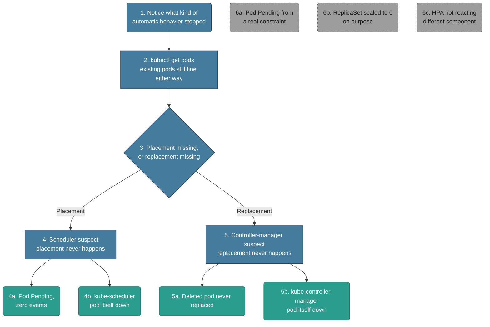

# Troubleshooting: Scheduler vs. Controller-Manager (Discrimination)

*Built 2026-10-25 via `/troubleshootingk8s`. These two share the exact same entry signal — apiserver's healthy, existing pods keep running untouched, but some automatic behavior has silently stopped — which makes telling them apart the actual interview-worthy skill, not just knowing they exist. Assumes apiserver is already confirmed healthy; if it's not, see `02-apiserver-unreachable.md` first.*

## Diagram (plain text — no renderer needed)

```text
apiserver is healthy, but something automatic stopped happening
│
├─ 1-2. Notice what kind of "automatic" stopped
│       RUN: kubectl get pods  (watch for the pattern, not one pod)
│       Existing pods still running fine either way
│
└─ 3. Is this about NEW pods never getting PLACED,
      or EXISTING pods never getting REPLACED?
      │
      ├─ PLACEMENT never happens → 4. Scheduler suspect
      │         RUN: kubectl describe pod <name>  (any events at all?)
      │         ├─ 4a. Pod stuck Pending, literally zero events
      │         └─ 4b. kube-scheduler pod itself is down
      │
      └─ REPLACEMENT never happens → 5. Controller-manager suspect
                RUN: kubectl delete pod <name>  (does a new one ever appear?)
                ├─ 5a. Deleted/crashed pod never gets a replacement
                └─ 5b. kube-controller-manager pod itself is down

Off-path (looks like one of these, but isn't):
  6a. Pod Pending from a real constraint  - scheduler working correctly, see 01-pending-pods.md
  6b. ReplicaSet intentionally scaled to 0 - no replacement is the CORRECT behavior, not a failure
  6c. HPA/autoscaler not reacting          - a different component entirely, not controller-manager core
```

## Diagram (Mermaid — optional, skip this if it doesn't render for you; the text tree above and the walkthrough below have the same information)



## Written Walkthrough (the actual train of thought, not just facts)

### Steps 1-2 — First Glance

- **What I run:** `kubectl get pods` — but I'm not reading one pod's status, I'm watching for a *pattern* across the cluster.
- **What I'm actually watching for:** existing pods are all still running fine, untouched — that's the tell that this isn't apiserver and isn't kubelet, since neither scheduler nor controller-manager are needed to keep an already-running pod alive. Something *automatic and forward-looking* has stopped, not something ongoing.

### Step 3 — The Fork (the actual discrimination)

- **The real question:** is this about pods that need to be *placed* (new pods never land on a node), or pods that need to be *replaced* (a pod disappeared and nothing filled the gap)?
- **Why this is the hard part:** both scheduler-down and controller-manager-down look identical at a glance — "something that should happen automatically, isn't." The only way to actually tell them apart is to look at *which side of the lifecycle* is stuck: scheduler owns getting a pod onto a node in the first place; controller-manager owns noticing a pod is missing and asking for a new one. One test pod makes this obvious: if a brand-new pod never gets a node assigned, that's scheduler territory. If an *existing* managed pod gets deleted and nothing new appears, that's controller-manager territory.

### Step 4 — Scheduler Suspect (placement isn't happening)

- **Why this happens:** the scheduler component itself isn't running cluster-wide, not just one pod hitting a constraint.

**4a. Pod stuck Pending, literally zero events**
- This looks exactly like the "silence" leaf in `01-pending-pods.md` (4f) on the surface — but there, the cause was a specific pod's `schedulerName`/`schedulingGates`. Here, I suspect the scheduler *component* isn't running at all, so I'd expect to see this on *every* new pod, not just one.
- **What the message looks like:**
  ```
  $ kubectl get pods
  NAME    READY   STATUS    RESTARTS   AGE
  myapp   0/1     Pending   0          5m

  $ kubectl describe pod myapp
  Events:  <none>
  ```
- **Fix:** confirm the scope first (one pod or every new pod?), then move to 4b to check the scheduler itself.

**4b. kube-scheduler pod itself is down**
- The direct confirmation — if it's crashlooping or missing, that explains every Pending pod with no events at once.
- **What the message looks like:**
  ```
  $ kubectl get pods -n kube-system | grep scheduler
  kube-scheduler-node-1   0/1   CrashLoopBackOff   6   10m
  ```
- **Fix:** restart kube-scheduler (restart the static pod, check its manifest wasn't moved/misconfigured). Tradeoff: no new pods get placed anywhere during the outage; already-running pods are completely unaffected.

### Step 5 — Controller-Manager Suspect (replacement isn't happening)

- **Why this happens:** the reconciliation loop that notices "a managed pod is missing" and asks for a replacement has stopped, while kubelet keeps whatever's already running going just fine.

**5a. Deleted/crashed pod never gets a replacement**
- Key distinguishing fact: I'd specifically test this by deleting one pod myself and watching whether a replacement *ever* shows up, not just slowly.
- **What the message looks like:**
  ```
  $ kubectl delete pod myapp-7d9f8c-abcde
  pod "myapp-7d9f8c-abcde" deleted

  $ kubectl get pods
  (no replacement pod ever appears, even after waiting several minutes)
  ```
- **Fix:** confirm the scope (does this happen for every Deployment, or just one?), then move to 5b.

**5b. kube-controller-manager pod itself is down**
- The direct confirmation — if it's down, no ReplicaSet/Deployment anywhere in the cluster is being reconciled.
- **What the message looks like:**
  ```
  $ kubectl get pods -n kube-system | grep controller-manager
  kube-controller-manager-node-1   0/1   Error   4   8m
  ```
- **Fix:** restart kube-controller-manager. Tradeoff: reconciliation is fully paused for the entire outage window — any pod failures during that time won't self-heal until it's back.

### Step 6 — Off-Path: Sanity-Check Before Committing

**6a. Pod Pending from a real constraint** — if there *are* FailedScheduling events naming a real reason (insufficient resources, taint, affinity), the scheduler is working correctly and just can't satisfy the constraint — that's `01-pending-pods.md`'s territory, not "scheduler is down."
**6b. ReplicaSet intentionally scaled to 0** — if someone deliberately scaled a Deployment down (or deleted it outright), no replacement appearing is the *correct* behavior, not a controller-manager failure. Check `kubectl get deployment <name>` for the actual desired replica count before assuming anything's broken.
**6c. HPA/autoscaler not reacting** — a HorizontalPodAutoscaler not scaling up under load is a different component and a different investigation (metrics-server health, HPA's own events) — it's not the core controller-manager reconciliation loop this file is about.

## Signal Table

| # | Signal | Why it points here | Confirm command | Fix / tradeoff |
|---|---|---|---|---|
| 4a | **Pod Pending, zero events** | A new pod never gets placed — the scheduler never even attempted it | `kubectl describe pod <name>` (confirm truly zero events, and check if this is happening to *every* new pod) | Move to 4b to confirm the component itself. |
| 4b | **kube-scheduler pod down** | Direct confirmation — the component responsible for placement isn't running | `kubectl get pods -n kube-system \| grep scheduler`; scheduler logs | Restart kube-scheduler. Tradeoff: no new placements during the outage; running pods unaffected. |
| 5a | **Deleted pod never replaced** | An existing managed pod disappeared and nothing filled the gap — reconciliation never fired | `kubectl delete pod <name>` and watch; check if this happens across multiple Deployments | Move to 5b to confirm the component itself. |
| 5b | **kube-controller-manager pod down** | Direct confirmation — the reconciliation loop isn't running | `kubectl get pods -n kube-system \| grep controller-manager`; controller-manager logs | Restart kube-controller-manager. Tradeoff: reconciliation paused for the whole outage window. |

## What You'd Actually See (example output per signal)

**4a.**
```
NAME    READY   STATUS    RESTARTS   AGE
myapp   0/1     Pending   0          5m
```

**4b.**
```
$ kubectl get pods -n kube-system | grep scheduler
kube-scheduler-node-1   0/1   CrashLoopBackOff   6   10m
```

**5a.**
```
$ kubectl delete pod myapp-7d9f8c-abcde
pod "myapp-7d9f8c-abcde" deleted
$ kubectl get pods
(no new pod appears)
```

**5b.**
```
$ kubectl get pods -n kube-system | grep controller-manager
kube-controller-manager-node-1   0/1   Error   4   8m
```

## How to Say It Out Loud (interview script)

1. **Data first:** "If apiserver's healthy but something automatic stopped — new pods aren't landing, or missing pods aren't coming back — existing pods staying up tells me it's not kubelet, so it's scheduler or controller-manager."
2. **State the fork:** "The real question is whether this is about *placing* new pods or *replacing* missing ones, because those are two different components with two different jobs."
3. **One observation, then one check:** "If a brand-new pod sits Pending with zero events, I'd suspect the scheduler itself before assuming it's a constraint issue — I'd check if every new pod is affected, not just one."
4. **Fix plus tradeoff:** "The fix is just restarting the affected component, but the real cost is the outage window — nothing self-heals or gets placed the whole time it's down, so duration matters more than the fix itself."
5. **Prevention:** "I'd alert on the scheduler and controller-manager pods directly in kube-system, not just on symptoms like 'pod stuck Pending,' since the direct signal is faster to act on."

## Validation notes

*Checked 2026-10-25 against current Kubernetes behavior. The placement-vs-replacement fork is right. The sharper, non-destructive way to run it:*

- **Create a throwaway Deployment instead of deleting a real pod:** `kubectl create deployment probe --image=nginx`, then `kubectl get rs,pods -l app=probe`.
  - **No ReplicaSet appears** → controller-manager. The Deployment controller never reacted, so no pod object was ever created.
  - **ReplicaSet and pod exist, pod is Pending with zero events** → scheduler. The controller did its job; nobody placed the pod.
  - This matters because "new pods never get placed" can be *either* component: with controller-manager down, a new Deployment produces no pods at all — which, at a glance, also looks like "nothing's landing."
- **Other controller-manager fingerprints:** namespaces stuck in `Terminating`, Service Endpoints not updating when pods change, NotReady nodes never getting their pods evicted. All of them are reconcile loops that stopped.
- **HA control planes:** with three control-plane nodes, only one scheduler and one controller-manager are *active* at a time (leader election). `kubectl get lease -n kube-system kube-scheduler kube-controller-manager` shows who holds the lease and when it last renewed — a stale `renewTime` means the leader is wedged even if its pod says Running.
- **Managed clusters:** on EKS/GKE/AKS these pods aren't visible in `kube-system`; you infer them from symptoms and the provider's control-plane logs.
