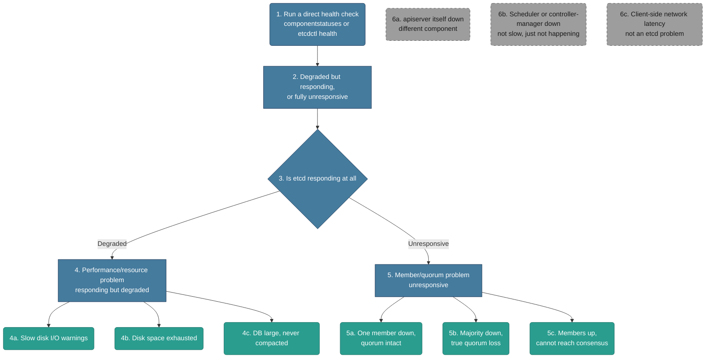

# Troubleshooting: etcd Failure

*Built 2026-10-25 via `/troubleshootingk8s`. A different domain entirely from scheduler/controller-manager — this is about the cluster's actual source of truth (consensus/storage), not about which reconciliation loop stopped. Assumes apiserver is reachable but the cluster feels slow, inconsistent, or a direct health check already failed.*

## Diagram (plain text — no renderer needed)

```text
Cluster feels slow/flaky, or a direct etcd health check failed
│
├─ 1-2. Run a direct health check
│       RUN: kubectl get componentstatuses  (or) etcdctl endpoint health --cluster
│       Degraded-but-responding, or fully unresponsive?
│
└─ 3. Is etcd responding at all, even slowly?
      │
      ├─ YES, but degraded → 4. Performance/resource problem
      │         RUN: check etcd logs + disk usage on etcd nodes
      │         ├─ 4a. Slow disk I/O warnings in etcd logs
      │         ├─ 4b. Disk space exhausted (NOSPACE alarm)
      │         └─ 4c. DB grown large, never compacted/defragmented
      │
      └─ NO, unresponsive → 5. Member/quorum problem
                RUN: etcdctl member list  (how many members are actually up)
                ├─ 5a. One member down, quorum still intact
                ├─ 5b. Majority of members down - true quorum loss, "no leader"
                └─ 5c. Members up individually, but can't reach consensus (peer TLS/cert issue)

Off-path (looks like etcd, but isn't):
  6a. apiserver itself down       - different component entirely, see 02-apiserver-unreachable.md
  6b. Scheduler/controller-manager down - "things aren't happening," not "things are slow/inconsistent"
  6c. Client-side network latency - kubectl feels slow for reasons that have nothing to do with etcd
```

## Diagram (Mermaid — optional, skip this if it doesn't render for you; the text tree above and the walkthrough below have the same information)



## Written Walkthrough (the actual train of thought, not just facts)

### Steps 1-2 — First Glance

- **What I run:** `kubectl get componentstatuses` (deprecated but still informative) or a direct `etcdctl endpoint health --cluster` call.
- **Why I don't just go on vibes:** "things feel slow" is a real early etcd signal, but it's also vague enough to be wrong — I want a direct confirmation before I commit to this being an etcd problem at all.
- **What I'm watching for:** does etcd respond at all (even slowly, even with a warning), or does it not respond/report a leader at all?

### Step 3 — The Fork

- **The real question:** is etcd degraded-but-functional, or is it genuinely not able to serve requests?
- **Why this split matters:** a degraded-but-responding etcd is a resource problem (disk, DB size) — the cluster is still technically working, just slow. A genuinely unresponsive etcd is a quorum/membership problem — writes may be fully blocked, which is a much more serious, much more urgent situation.

### Step 4 — Degraded But Responding (performance/resource problem)

**4a. Slow disk I/O warnings in etcd logs**
- etcd is extremely latency-sensitive to disk writes, since every write has to be fsync'd to disk before it's considered committed — slow disks show up directly as etcd slowness.
- **What the message looks like:**
  ```
  {"level":"warn","msg":"apply request took too long","took":"1.2s","expected-duration":"100ms"}
  {"level":"warn","msg":"failed to send out heartbeat on time (exceeded the 100ms timeout for 800.1ms)"}
  ```
- **Fix:** move etcd onto faster disks (SSD, not network-attached spinning storage), or reduce contention on the existing disk. Tradeoff: migrating etcd's data directory to new storage is a real, careful operation — not something to do live without a backup first.

**4b. Storage quota exhausted (NOSPACE alarm)**
- etcd actively protects itself once its database hits its size quota — it sets an alarm and stops accepting writes entirely (reads still work). The quota is `--quota-backend-bytes`, **2 GiB by default** — so this fires on DB size, usually with plenty of free disk. A truly full disk can cause it too, but don't assume that's what you're looking at.
- **What the message looks like:**
  ```
  $ etcdctl alarm list
  memberID:12345 alarm:NOSPACE
  ```
- **Fix:** shrink the database — compact old revisions, then defrag each member (4c) — then explicitly clear the alarm (`etcdctl alarm disarm`); it won't clear itself even after space is reclaimed. Raise the quota only if the cluster genuinely needs more. Tradeoff: don't skip the disarm step or writes stay blocked even after the real problem is fixed.

**4c. DB grown large, never compacted/defragmented**
- etcd keeps historical revisions of every key until they're compacted. In Kubernetes, apiserver already compacts every 5 minutes by default — but compaction only marks space as free *inside* the file. The file on disk doesn't shrink until you **defrag**, so a cluster with lots of churn (big ConfigMaps, many Events) can sit near the quota even though most of the file is empty pages.
- **What the message looks like:**
  ```
  $ etcdctl endpoint status --write-out=table
  +--------+------------------+---------+
  | ENDPOINT | DB SIZE | ... |
  +--------+------------------+---------+
  | 127.0.0.1:2379 | 2.1 GB | ... |
  ```
- **Fix:** run compaction (`etcdctl compact <revision>`) followed by defrag (`etcdctl defrag`) on each member. Tradeoff: defrag blocks that member while running and should be done one member at a time, never all at once, to avoid losing quorum mid-operation.

### Step 5 — Unresponsive (member/quorum problem)

**5a. One member down, quorum still intact**
- In a standard 3-member cluster, losing 1 member still leaves 2 — a majority — so the cluster keeps functioning, just with reduced fault tolerance.
- **What the message looks like:**
  ```
  $ etcdctl member list
  1, started, etcd-1, ..., started
  2, started, etcd-2, ..., started
  3, unstarted, etcd-3, ..., unreachable
  ```
- **Fix:** restart or replace the failed member. Tradeoff: the cluster is still up, but running on zero spare fault-tolerance until this is fixed — a second failure right now would be genuine quorum loss.

**5b. Majority of members down — true quorum loss**
- This is the serious one: with no majority, etcd can't elect a leader, and *no writes can be committed at all* — this isn't degraded, it's fully blocked.
- **What the message looks like:**
  ```
  # apiserver logs:
  etcdserver: request timed out, possibly due to connectivity lost, or server slow to respond to the request

  $ etcdctl endpoint status --cluster
  (no member reports itself as leader)
  ```
- **Fix:** restore from the most recent snapshot backup if members can't be recovered. Tradeoff: real, often unavoidable data loss for anything written since that snapshot — this is exactly why backup cadence (`etcdctl snapshot save`, done on a schedule) is an operational concern, not an afterthought.

**5c. Members up individually, but can't reach consensus**
- A subtler case: each member looks healthy on its own, but they can't talk to *each other* — usually a peer-to-peer TLS/cert issue or a network partition between etcd nodes specifically, distinct from client-to-etcd connectivity.
- **What the message looks like:**
  ```
  {"level":"warn","msg":"failed to dial","peer-id":"...","error":"x509: certificate signed by unknown authority"}
  ```
- **Fix:** fix the peer certificates/CA trust between etcd members, or the network path between them specifically (not the client-facing path). Tradeoff: none major once correctly diagnosed, but easy to misdiagnose as a client-facing problem if you don't check peer-to-peer connectivity specifically.

### Step 6 — Off-Path: Sanity-Check Before Committing

**6a. apiserver itself down** — a completely different component and a completely different file (`02-apiserver-unreachable.md`) — if `kubectl` doesn't respond at all, check apiserver first, since etcd health checks run *through* apiserver in some forms (like `componentstatuses`).
**6b. Scheduler/controller-manager down** — "things aren't happening" (new pods not placed, deleted pods not replaced) is a different symptom family than "things are slow/inconsistent" — see `03-scheduler-vs-controller-manager.md`.
**6c. Client-side network latency** — before concluding etcd is degraded, rule out your own network path (VPN, proxy) — slow `kubectl` from your laptop can look identical to slow etcd from where you're sitting.

## Signal Table

| # | Signal | Why it points here | Confirm command | Fix / tradeoff |
|---|---|---|---|---|
| 4a | **Slow disk I/O warnings** | etcd fsyncs every write to disk — slow disks directly cause etcd latency | etcd logs (`apply request took too long`, heartbeat warnings) | Move to faster disks. Tradeoff: migrating the data directory needs a backup first. |
| 4b | **NOSPACE alarm** | etcd deliberately blocks writes once the DB hits its quota (2 GiB default), to avoid unbounded growth | `etcdctl alarm list`; DB SIZE in `endpoint status` | Compact + defrag, then `etcdctl alarm disarm` explicitly. Tradeoff: writes stay blocked if you skip the disarm step. |
| 4c | **DB large, uncompacted** | Historical revisions accumulate until compacted; growth degrades performance before hitting NOSPACE | `etcdctl endpoint status --write-out=table` (DB SIZE column) | Compact then defrag, one member at a time. Tradeoff: defrag blocks that member during the operation. |
| 5a | **One member down, quorum intact** | Reduced fault tolerance, but still functional with a majority present | `etcdctl member list` | Restart/replace the member. Tradeoff: zero spare tolerance until fixed. |
| 5b | **Majority down, quorum loss** | No leader can be elected — writes are fully blocked, not just slow | apiserver logs (`etcdserver: request timed out`); `etcdctl endpoint status --cluster` (no leader) | Restore from snapshot backup. Tradeoff: real data loss since the last snapshot. |
| 5c | **Members up, can't reach consensus** | Peer-to-peer TLS/network issue between etcd nodes specifically, not client-facing | etcd logs (peer dial/TLS errors) | Fix peer certs/trust or the inter-member network path. Tradeoff: easy to misdiagnose as client-facing. |

## What You'd Actually See (example output per signal)

**4a.**
```
{"level":"warn","msg":"apply request took too long","took":"1.2s","expected-duration":"100ms"}
```

**4b.**
```
$ etcdctl alarm list
memberID:12345 alarm:NOSPACE
```

**4c.**
```
$ etcdctl endpoint status --write-out=table
| 127.0.0.1:2379 | 2.1 GB | ... |
```

**5a.**
```
$ etcdctl member list
1, started, etcd-1, ..., started
2, started, etcd-2, ..., started
3, unstarted, etcd-3, ..., unreachable
```

**5b.**
```
etcdserver: request timed out, possibly due to connectivity lost, or server slow to respond to the request
```

**5c.**
```
{"level":"warn","msg":"failed to dial","peer-id":"...","error":"x509: certificate signed by unknown authority"}
```

## How to Say It Out Loud (interview script)

1. **Data first:** "If things feel slow or inconsistent, I don't go on vibes — I run a direct health check against etcd, because 'feels slow' and 'is actually degraded' aren't the same thing."
2. **State the fork:** "The real question is whether etcd's responding at all, even slowly, or genuinely unresponsive — degraded is a resource problem, unresponsive is a quorum problem, and those are very different urgency levels."
3. **One observation, then one check:** "If it's degraded, I'd check disk I/O and DB size before assuming it's a quorum issue — most degraded-but-working etcd problems are resource problems, not membership problems."
4. **Fix plus tradeoff:** "If it's actually quorum loss, the fix is restoring from the latest snapshot — but that means accepting data loss for anything written since that backup, which is exactly why backup frequency is a real operational decision, not a checkbox."
5. **Prevention:** "I'd want alerting on etcd disk usage, DB size, and member health directly, plus a real tested backup/restore cadence — not just assuming the default setup is enough."

## Validation notes

*Checked 2026-10-25 against current etcd/Kubernetes behavior. Corrections above: NOSPACE is about the DB quota, not just a full disk, and apiserver already handles compaction — defrag is the step that's usually missing.*

- **etcdctl needs certs on a kubeadm cluster.** Bare `etcdctl endpoint health` will fail and look like an outage. The real command, run on a control-plane node:
  `etcdctl --endpoints=https://127.0.0.1:2379 --cacert=/etc/kubernetes/pki/etcd/ca.crt --cert=/etc/kubernetes/pki/etcd/server.crt --key=/etc/kubernetes/pki/etcd/server.key endpoint health --cluster`
- **The fork is really "is there a leader?"** 5a (one of three down) still has a leader and serves requests normally — it's only listed under "unresponsive" because `member list` is where you'd spot it. What actually splits the branches is whether a majority is up.
- **Quorum math:** members = 2f + 1 tolerates f failures. 3 tolerates 1, 5 tolerates 2. 4 still only tolerates 1 — even counts add cost without adding fault tolerance.
- **How it reaches you:** quorum loss usually doesn't look like "etcd" first. apiserver either returns `etcdserver: request timed out` (a 5xx — file 02's 5c) or crashloops on startup, which looks like "connection refused" (file 02's 4a).
- **Restore:** `etcdutl snapshot restore` (the `etcdctl` version is deprecated) writes a *new* data directory; then point the etcd static pod manifest at it. Restore is the last resort — if a majority of members can be brought back, do that first and lose nothing.
- **Frequent leader elections** in the logs (`elected leader`, `lost leader`) are usually 4a in disguise — slow disk fsync makes heartbeats miss their window.
