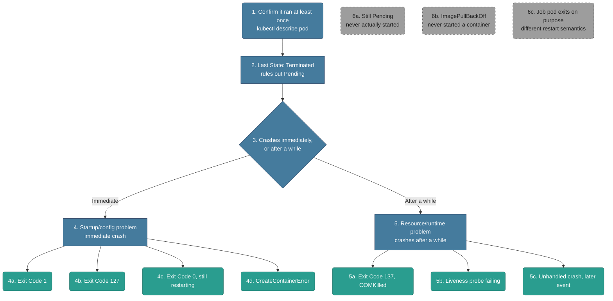

# Troubleshooting: CrashLoopBackOff

*Built 2026-10-25 via `/troubleshootingk8s`. The natural pairing with Pending Pods (`01-pending-pods.md`) — that file covers a pod that never gets Running; this one covers a pod that got Running, then started dying repeatedly. Signal-driven, not a memorized cause list.*

## Diagram (plain text — no renderer needed)

```text
Pod STATUS: CrashLoopBackOff, RESTARTS climbing
│
├─ 1-2. Confirm it actually ran at least once
│       RUN: kubectl describe pod <name>  (check Last State: Terminated)
│       This already rules out Pending - the container DID start
│
└─ 3. Does it crash almost immediately, or run for a while first?
      │
      ├─ IMMEDIATE  → 4. Startup/config problem
      │         RUN: kubectl logs <name> --previous
      │         ├─ 4a. Exit Code 1 - generic app startup error
      │         ├─ 4b. Exit Code 127 - command not found
      │         ├─ 4c. Exit Code 0 but still restarting - one-shot script, restartPolicy: Always
      │         └─ 4d. CreateContainerError - bad command/entrypoint at the spec level
      │
      └─ AFTER A WHILE → 5. Resource/runtime problem
                RUN: kubectl describe pod <name>  (check Reason + Exit Code + timestamps)
                ├─ 5a. Exit Code 137, Reason OOMKilled
                ├─ 5b. Liveness probe failing - kubelet is killing a technically-running app
                └─ 5c. Unhandled crash triggered by a later event

Off-path (looks like CrashLoopBackOff, but isn't):
  6a. Still Pending/ContainerCreating - never actually started, see 01-pending-pods.md
  6b. ImagePullBackOff               - never started a container at all, see 01-pending-pods.md 5a
  6c. Job/CronJob pod exits on purpose - restartPolicy OnFailure/Never, different semantics entirely
```

## Diagram (Mermaid — optional, skip this if it doesn't render for you; the text tree above and the walkthrough below have the same information)



## Written Walkthrough (the actual train of thought, not just facts)

### Steps 1-2 — First Glance

- **What I run:** `kubectl describe pod myapp` and look specifically at `Last State: Terminated`.
- **What this already confirms:** unlike Pending, this container genuinely started running at some point — RESTARTS is nonzero, which by itself proves that. The question isn't "did it start," it's "why does it keep dying."
- **What I'm actually watching for:** the gap between `Started` and `Finished` timestamps — that single number tells me which half of the problem I'm in before I even read the reason.

### Step 3 — The Fork

- **The real question:** does the container die almost immediately after starting (within a second or two), or does it run for a while — seconds to minutes — before crashing?
- **Why this split matters:** these point at completely different layers. An immediate crash means the container never really got going — something's wrong before the app even finishes initializing (bad command, bad config, missing file). A delayed crash means the app *did* start successfully and something happened *during* operation — a resource limit, a health check, a specific later event.
- **What I run:** the same `Started`/`Finished` timestamps from step 1-2 — I'm reading the gap between them, not running a new command.

### Step 4 — Immediate Crash (startup/config problem)

**4a. Exit Code 1 — generic app startup error**
- First thought: the application itself is throwing an error right at startup — bad environment variable, missing config file, a dependency it can't reach during init.
- **What the message looks like:**
  ```
  $ kubectl get pods
  NAME    READY   STATUS             RESTARTS      AGE
  myapp   0/1     CrashLoopBackOff   5 (45s ago)   4m

  Last State:   Terminated
    Reason:     Error
    Exit Code:  1
  ```
- **Fix:** read the actual startup error with `kubectl logs myapp --previous` and fix whatever it's complaining about. No real tradeoff — this is a straightforward debugging step.

**4b. Exit Code 127 — command not found**
- A specific, recognizable exit code: 127 is the shell's own "command not found." You see it when a shell is involved — `command: ["sh", "-c", "start-server"]`, or a startup script calling a binary that isn't in the image. The shell started fine; the thing it tried to run didn't exist.
- If the *entrypoint itself* is missing (no shell in between), the runtime fails before anything runs — that's 4d's `CreateContainerError` / `StartError` (often exit 128), not 127.
- `exec /app/start.sh: no such file or directory` when the file clearly *is* there usually means its interpreter isn't: a `#!/bin/bash` script in an image with no bash, or Windows line endings (`#!/bin/sh\r`). Its cousin `exec format error` means the image was built for the wrong CPU architecture (arm64 image on an amd64 node).
- **What the message looks like:**
  ```
  Last State:   Terminated
    Reason:     Error
    Exit Code:  127

  $ kubectl logs myapp --previous
  exec /app/start.sh: no such file or directory
  ```
- **Fix:** fix the `command`/`args` in the pod spec, or confirm the binary actually exists at that path in the image. No real tradeoff.

**4c. Exit Code 0, but still restarting**
- The genuine gotcha here: exit code 0 means the process exited *successfully* — nothing actually failed. It's still restarting because `restartPolicy: Always` (the default for Deployments) tells kubelet to restart *any* exited container, success or not.
- Real giveaway: this is usually a one-shot script or batch job accidentally deployed as a long-running service.
- **What the message looks like:**
  ```
  Last State:   Terminated
    Reason:     Completed
    Exit Code:  0
  ```
- **Fix:** if it's genuinely meant to run once, move it to a Job (with `restartPolicy: OnFailure` or `Never`) instead of a Deployment. Tradeoff: this is a real design-level change, not a quick patch — a Deployment can't be given a non-`Always` restart policy at all.

**4d. CreateContainerError**
- Different from the above — this fails *before* the runtime even gets a container running, at the Kubernetes/runtime spec level, not inside the app.
- **What the message looks like:**
  ```
  NAME    READY   STATUS               RESTARTS   AGE
  myapp   0/1     CreateContainerError  0          10s

  Events:
    Warning  Failed  kubelet  Error: failed to create containerd task: ... executable file not found in $PATH
  ```
- **Fix:** fix the command/entrypoint at the spec level, same root category as 4b but caught one layer earlier by the runtime itself. No real tradeoff.

### Step 5 — Crashes After a While (resource/runtime problem)

**5a. Exit Code 137, Reason OOMKilled**
- The app genuinely started and ran — it just grew past its memory limit and the kernel OOM-killer stepped in. Exit code 137 is always `128 + 9` (SIGKILL), and `OOMKilled` is kubelet's own label for *why* that SIGKILL happened.
- **What the message looks like:**
  ```
  Last State:   Terminated
    Reason:     OOMKilled
    Exit Code:  137
  ```
- **Fix:** raise the memory limit if the usage is legitimate, or fix an actual memory leak in the app. Tradeoff: raising the limit without checking for a leak just delays the same crash at a higher threshold, and increases memory pressure risk on the node for other pods.

**5b. Liveness probe failing**
- The app is technically still running — this isn't the app crashing on its own, it's kubelet deciding the app is unhealthy and killing it itself.
- **What the message looks like:**
  ```
  Events:
    Warning  Unhealthy  kubelet  Liveness probe failed: HTTP probe failed with statuscode: 500
    Normal   Killing    kubelet  Container myapp failed liveness probe, will be restarted
  ```
- **Fix:** fix whatever the probe endpoint is actually checking (the real app health), or fix an over-aggressive probe (too short a timeout, too few allowed failures) if the app just needs more time. Tradeoff: loosening the probe risks not catching a genuine hang — the real fix is almost always the app itself, not the probe config.

**5c. Unhandled crash triggered by a later event**
- The hardest one to generalize — the app ran fine for a while, then something specific (a particular request, a dependency that eventually times out) triggered an unhandled exception.
- **What the message looks like:**
  ```
  $ kubectl logs myapp --previous
  ...
  Unhandled exception: NullPointerException at com.example.Handler.process(Handler.java:42)
  ```
- **Fix:** fix the actual bug — there's no shortcut here, you need the real stack trace from `--previous` logs. No real tradeoff, just time.

### Step 6 — Off-Path: Sanity-Check Before Committing

**6a. Still Pending/ContainerCreating** — if the container never actually started at all, this isn't CrashLoopBackOff territory — see `01-pending-pods.md`.
**6b. ImagePullBackOff** — the pod never got far enough to run *any* container — a different failure mode entirely, see `01-pending-pods.md`'s 5a.
**6c. Job/CronJob pod exits on purpose** — a Job with `restartPolicy: OnFailure` or `Never` exiting and *not* being endlessly restarted is correct behavior, not a bug — don't mistake its backoff-and-retry semantics (governed by `backoffLimit`) for a Deployment's CrashLoopBackOff.

## Signal Table

| # | Signal | Why it points here | Confirm command | Fix / tradeoff |
|---|---|---|---|---|
| 4a | **Exit Code 1** | Generic app-level startup error | `kubectl logs <name> --previous` | Fix whatever the startup log names. No real tradeoff. |
| 4b | **Exit Code 127** | Shell's "command not found" — entrypoint doesn't exist in the image | `kubectl logs <name> --previous`; check `command`/`args` in spec | Fix the command path. No real tradeoff. |
| 4c | **Exit Code 0, still restarting** | Process exits successfully, but `restartPolicy: Always` restarts it anyway | `kubectl describe pod` (`Reason: Completed`, `Exit Code: 0`) | Move to a Job with `OnFailure`/`Never`. Tradeoff: real design change, not a quick patch. |
| 4d | **CreateContainerError** | Runtime-level failure before any container starts | `kubectl describe pod` (Events) | Fix command/entrypoint at the spec level. No real tradeoff. |
| 5a | **Exit Code 137, OOMKilled** | Exceeded memory limit, kernel OOM-killer sent SIGKILL | `kubectl describe pod` (`Last State`) | Raise memory limit or fix a leak. Tradeoff: raising the limit without fixing a leak just delays the crash. |
| 5b | **Liveness probe failing** | kubelet itself is killing a technically-running app | `kubectl describe pod` (Events: Unhealthy/Killing) | Fix the app's real health, or loosen an over-aggressive probe. Tradeoff: loosening risks missing a genuine hang. |
| 5c | **Unhandled crash, later event** | App ran fine, then a specific trigger caused an unhandled exception | `kubectl logs <name> --previous` | Fix the actual bug. No shortcut. |

## What You'd Actually See (example output per signal)

**4a.** `Last State: Terminated, Reason: Error, Exit Code: 1`
**4b.** `Last State: Terminated, Reason: Error, Exit Code: 127` + `exec /app/start.sh: no such file or directory`
**4c.** `Last State: Terminated, Reason: Completed, Exit Code: 0`
**4d.** `Events: Warning Failed kubelet Error: failed to create containerd task: ... executable file not found in $PATH`
**5a.** `Last State: Terminated, Reason: OOMKilled, Exit Code: 137`
**5b.** `Events: Warning Unhealthy kubelet Liveness probe failed: HTTP probe failed with statuscode: 500`
**5c.** `Unhandled exception: NullPointerException at com.example.Handler.process(Handler.java:42)`

## How to Say It Out Loud (interview script)

1. **Data first:** "RESTARTS counting up with STATUS CrashLoopBackOff tells me the container actually started at least once — this isn't a scheduling or kubelet-startup problem, something's making it die after it runs."
2. **State the fork:** "The first thing I check is whether it crashes immediately or after running a while, because that tells me whether I'm looking at a startup/config bug or a resource/runtime problem."
3. **One observation, then one check:** "If it's Exit Code 137 with Reason OOMKilled, I'd check actual memory usage against the limit before just raising the limit — I want to know if this is legitimate growth or a leak."
4. **Fix plus tradeoff:** "If it's a liveness probe killing an otherwise-fine app, I'd fix the app's real health first — loosening the probe just hides the problem instead of fixing it."
5. **Prevention:** "I'd want memory usage trends and probe failure rates visible over time, not just the current crash — a slow leak looks completely different from a single bad deploy if you're watching the trend."

## Validation notes

*Checked 2026-10-25 against current Kubernetes behavior. The immediate-vs-later fork is right. Correction above: what exit 127 actually tells you. Additions:*

- **4d is technically off-path for this file.** `CreateContainerError` has RESTARTS 0 — the container never started, which is file 01's territory (kubelet-side). It lives here because it's the same root cause as 4b (bad command), just caught one layer earlier.
- **Exit codes above 128 are signals:** code − 128 = the signal number. 137 = SIGKILL (9), 143 = SIGTERM (15). 137 without `Reason: OOMKilled` means something else killed it — most often a liveness-probe restart where the app ignored SIGTERM until the grace period ran out. 143 means it shut down cleanly when asked.
- **Readiness ≠ liveness.** A failing *readiness* probe never restarts anything — it only pulls the pod out of Service endpoints (READY 0/1, RESTARTS stays put). Only *liveness* failures restart the container. If RESTARTS is climbing, readiness is not your culprit.
- **The classic 5b:** a slow-starting app (JVM, big migrations) with a liveness probe that starts checking before the app is up. It gets killed mid-boot, every boot. The fix is a `startupProbe`, which holds off liveness until the app has started once — not a looser liveness probe.
- **The backoff itself:** kubelet waits 10s, 20s, 40s… capped at 5 minutes between restarts. That's why a pod that's been crashing for an hour seems to restart "rarely" — and why `--previous` logs are what you want, since the current container may have barely run.
- **Node-level kills look different:** if the *node* runs out of memory, kubelet evicts pods — STATUS `Evicted`/`Failed`, not CrashLoopBackOff, and the pod doesn't restart in place.
