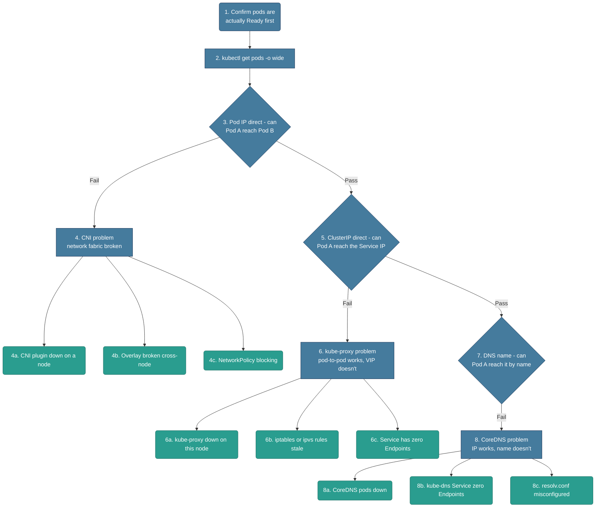

# Troubleshooting: Networking/Services (kube-proxy vs. CNI vs. CoreDNS)

*Built 2026-10-25 via `/troubleshootingk8s`. Entry signal: the pod is already Running and Ready — this file is specifically about "my pods are healthy, but traffic still doesn't work." Unlike the other files, this one is a sequential ladder, not a single fork — each rung's PASS sends you to the next rung, and the rung where it first FAILS tells you which component is actually broken.*

## Diagram (plain text — no renderer needed)

```text
Pods are Running and Ready, but something's still unreachable
│
├─ 1-2. Confirm pods are actually Ready first
│       RUN: kubectl get pods -o wide
│       If not Ready, this isn't a networking problem - go elsewhere
│
├─ 3. RUNG 1 - Can Pod A reach Pod B directly, by Pod IP?
│       RUN: kubectl exec podA -- curl -m 3 <podB-ip>:<port>
│       │
│       FAIL → 4. CNI problem (the network fabric itself is broken)
│       │       ├─ 4a. CNI plugin not installed/crashed on a node
│       │       ├─ 4b. Overlay/routing broken cross-node (same-node works, cross-node doesn't)
│       │       └─ 4c. NetworkPolicy blocking the traffic (selective, not total)
│       │
│       PASS ↓
│
├─ 5. RUNG 2 - Can Pod A reach the Service's ClusterIP directly?
│       RUN: kubectl exec podA -- curl -m 3 <clusterIP>:<port>
│       │
│       FAIL → 6. kube-proxy problem (pod-to-pod works, Service VIP doesn't)
│       │       ├─ 6a. kube-proxy pod down/crashlooping on this node
│       │       ├─ 6b. iptables/ipvs rules missing or stale
│       │       └─ 6c. Service has zero Endpoints (selector mismatch - a config issue, not kube-proxy health)
│       │
│       PASS ↓
│
└─ 7. RUNG 3 - Can Pod A reach it by the Service's DNS name?
        RUN: kubectl exec podA -- curl -m 3 http://myservice.default.svc.cluster.local
        │
        FAIL → 8. CoreDNS problem (IP-based access works, name resolution doesn't)
        │       ├─ 8a. CoreDNS pods down/crashlooping
        │       ├─ 8b. kube-dns Service itself has zero Endpoints
        │       └─ 8c. Pod's own /etc/resolv.conf misconfigured (dnsPolicy issue)
        │
        PASS → everything core is fine - look at app logic, external LB/Ingress, or a NetworkPolicy
                acting selectively on this specific path

Off-path (looks like a networking failure, but isn't):
  9a. Pod never became Ready       - readiness probe failing, not a networking-layer problem
  9b. NetworkPolicy working as intended - selective blocking, not a CNI outage (see 4c)
  9c. Missing namespace in the DNS name - "myservice" alone only resolves same-namespace
  9d. External LB/Ingress issue    - a completely different layer from ClusterIP/kube-proxy
```

## Diagram (Mermaid — optional, skip this if it doesn't render for you; the text tree above and the walkthrough below have the same information)



## Written Walkthrough (the actual train of thought, not just facts)

### Steps 1-2 — First Glance

- **What I run:** `kubectl get pods -o wide` — I confirm the pods involved are actually `Running` and `Ready` *before* I touch networking at all.
- **Why this matters first:** if a pod isn't Ready, the problem is upstream of networking entirely — a failing readiness probe, not a CNI/kube-proxy/CoreDNS issue. No point debugging the network for a pod that was never going to receive traffic anyway.

### The Ladder — Why Three Sequential Tests, Not One Fork

- **The real insight:** "my service isn't reachable" is one symptom with three completely different possible root causes, and the only way to actually tell them apart is to test in layers, from the most basic connectivity upward. Each rung either passes (move up a layer) or fails (that layer is where the problem lives).
- **Why this specific order:** Pod IP is the most fundamental layer — if two pods can't reach each other directly, nothing built on top of that (Services, DNS) has a chance. ClusterIP sits on top of working pod-to-pod connectivity. DNS sits on top of a working ClusterIP. Testing bottom-up means the first failure you hit *is* the answer — you don't need to guess which layer to check first.

### Rung 1 (Step 3) — Pod IP Direct

- **What I run:** from inside one pod, `curl` (or `ping`) the other pod's IP *directly* — no Service, no DNS, just raw pod-to-pod.
- **If this fails**, the network fabric itself is broken — this is the CNI's job, and nothing above this layer could possibly work either.

**4a. CNI plugin not installed/crashed on a node**
- First thought: if this fails cluster-wide, the plugin itself might not be running at all.
- **What the message looks like:**
  ```
  $ kubectl exec podA -- curl -m 3 <podB-ip>:8080
  curl: (7) Failed to connect to <podB-ip> port 8080: Connection timed out

  $ kubectl get pods -n kube-system -o wide | grep -i cni
  calico-node-x7f2k   0/1   CrashLoopBackOff   8   15m
  ```
- **Fix:** restart/reinstall the CNI plugin on the affected node(s). Tradeoff: a brief network interruption for every pod on that node while it restarts.

**4b. Overlay/routing broken cross-node**
- A more specific pattern: same-node pod-to-pod works fine, but cross-node fails — that's not "CNI is down," it's the overlay network (VXLAN, BGP peering, whatever the plugin uses) not actually connecting nodes to each other.
- **What the message looks like:**
  ```
  $ kubectl exec podA -- curl -m 3 <podB-same-node-ip>:8080
  HTTP/1.1 200 OK

  $ kubectl exec podA -- curl -m 3 <podC-different-node-ip>:8080
  curl: (7) Failed to connect... Connection timed out
  ```
- **Fix:** check the plugin's inter-node routing config — MTU mismatches, BGP peering status, or firewall rules between node IPs specifically. Tradeoff: often genuinely infra-team territory, not a quick kubectl fix.

**4c. NetworkPolicy blocking the traffic**
- The trap here: this *looks* identical to a CNI failure from the test alone, but it's policy working as configured, not the network being broken.
- The real tell: it's selective — only specific pod pairs matching the policy's selectors are blocked, not everything indiscriminately.
- **What the message looks like:**
  ```
  $ kubectl exec podA -- curl -m 3 <podB-ip>:8080
  curl: (28) Connection timed out

  $ kubectl get networkpolicy -A
  NAMESPACE   NAME              POD-SELECTOR
  default     deny-all-ingress  <none>
  ```
- **Fix:** adjust the NetworkPolicy to actually allow the needed traffic. Tradeoff: loosening it reduces the security boundary it existed to enforce — fix the policy's intent, don't just delete it.

### Rung 2 (Step 5) — ClusterIP Direct

- **What I run:** from the same pod, `curl` the Service's ClusterIP directly — by IP, not by name.
- **Why I only get here if Rung 1 passed:** pod-to-pod connectivity is already confirmed working, so if this specifically fails, the problem is isolated to the Service-routing layer — that's kube-proxy's job.

**6a. kube-proxy pod down/crashlooping**
- **What the message looks like:**
  ```
  $ kubectl exec podA -- curl -m 3 <clusterIP>:80
  curl: (7) Failed to connect to <clusterIP> port 80: Connection timed out

  $ kubectl get pods -n kube-system | grep kube-proxy
  kube-proxy-9k2lm   0/1   CrashLoopBackOff   5   10m
  ```
- **Fix:** restart kube-proxy on the affected node. Tradeoff: a brief Service-routing gap on that node while it restarts.

**6b. iptables/ipvs rules missing or stale**
- A subtler variant: kube-proxy's pod is actually `Running`, but the rules it's supposed to have programmed aren't actually there or are out of date.
- **What the message looks like:**
  ```
  # on the node:
  $ iptables -t nat -L | grep <service-name>
  (no matching rules found, even though kube-proxy pod is Running)
  ```
- **Fix:** restart kube-proxy to force rule reprogramming, or check for a dataplane-mode mismatch (iptables vs. ipvs) causing stale state. No major tradeoff.

**6c. Service has zero Endpoints**
- A config issue, not a kube-proxy health issue, but it produces an identical symptom — if the Service's selector doesn't actually match any pod's labels, there's nothing for kube-proxy to route to, healthy or not.
- **What the message looks like:**
  ```
  $ kubectl get endpoints myservice
  NAME        ENDPOINTS
  myservice   <none>

  $ kubectl get svc myservice -o yaml | grep -A2 selector
    selector:
      app: myapp-typo
  ```
- **Fix:** fix the Service's selector to actually match the pod's real labels. No real tradeoff once spotted.

### Rung 3 (Step 7) — DNS Name

- **What I run:** from the same pod, `curl` the Service by its full DNS name instead of its IP.
- **Why I only get here if Rung 2 passed:** ClusterIP routing is already confirmed working, so if only the *name* fails, the problem is isolated entirely to DNS resolution — CoreDNS's job.

**8a. CoreDNS pods down/crashlooping**
- **What the message looks like:**
  ```
  $ kubectl exec podA -- nslookup myservice.default.svc.cluster.local
  ;; connection timed out; no servers could be reached

  $ kubectl get pods -n kube-system | grep coredns
  coredns-5d78c9869d-abcde   0/1   CrashLoopBackOff   3   5m
  ```
- **Fix:** restart/scale the CoreDNS pods. Tradeoff: a brief DNS resolution gap during restart — worth running CoreDNS with multiple replicas specifically to avoid this being a single point of failure.

**8b. kube-dns Service itself has zero Endpoints**
- The same failure shape as 6c, just one layer up: CoreDNS pods are individually fine, but the Service fronting them has no endpoints — commonly after an upgrade changes a label CoreDNS pods carry.
- **What the message looks like:**
  ```
  $ kubectl get endpoints -n kube-system kube-dns
  NAME       ENDPOINTS
  kube-dns   <none>
  ```
- **Fix:** fix the kube-dns Service's selector/labels to match the actual CoreDNS pods. No major tradeoff.

**8c. Pod's own resolv.conf misconfigured**
- A per-pod issue, not a cluster-wide DNS outage — if only this one pod can't resolve names while others can, check its own DNS config, not CoreDNS's health.
- **What the message looks like:**
  ```
  $ kubectl exec podA -- cat /etc/resolv.conf
  nameserver 8.8.8.8
  (missing the cluster DNS IP entirely)
  ```
- **Fix:** set the pod's `dnsPolicy` to `ClusterFirst` (the actual default — check what overrode it). No real tradeoff.

### Off-Path: Sanity-Check Before Committing

**9a. Pod never became Ready** — if the pod isn't Ready at all, this is a readiness-probe problem, not anything in this file.
**9b. NetworkPolicy working as intended** — same trap as 4c: selective blocking by design isn't a CNI outage.
**9c. Missing namespace in the DNS name** — `myservice` alone only resolves within the *same* namespace; calling it cross-namespace needs `myservice.othernamespace` or the full FQDN — a very common mistake that looks exactly like "DNS is broken."
**9d. External LB/Ingress issue** — a completely separate layer from ClusterIP/kube-proxy entirely (the Ingress controller or cloud load balancer) — don't debug kube-proxy for a problem that's actually at the edge.

## Signal Table

| # | Signal | Why it points here | Confirm command | Fix / tradeoff |
|---|---|---|---|---|
| 4a | **CNI plugin down** | Network fabric itself isn't running on a node | `kubectl exec ... curl <pod-ip>`; `kubectl get pods -n kube-system -o wide \| grep cni` | Restart/reinstall CNI on the node. Tradeoff: brief network gap on that node. |
| 4b | **Overlay broken cross-node** | Same-node works, cross-node doesn't — inter-node routing is broken, not the plugin itself | Test same-node vs. cross-node pod IPs directly | Fix overlay/BGP/MTU config between nodes. Tradeoff: often infra-team territory. |
| 4c | **NetworkPolicy blocking** | Looks like CNI failure but is policy working as configured — selective, not total | `kubectl get networkpolicy -A` | Adjust the policy to allow the needed traffic. Tradeoff: loosening reduces its security boundary. |
| 6a | **kube-proxy down** | Pod-to-pod works, Service VIP routing specifically doesn't | `kubectl get pods -n kube-system \| grep kube-proxy` | Restart kube-proxy. Tradeoff: brief Service-routing gap on that node. |
| 6b | **iptables/ipvs stale** | kube-proxy running, but rules aren't actually programmed/current | `iptables -t nat -L \| grep <service>` on the node | Restart kube-proxy to reprogram rules. No major tradeoff. |
| 6c | **Service zero Endpoints** | Selector doesn't match any pod — nothing to route to regardless of kube-proxy health | `kubectl get endpoints <svc>`; compare Service selector to pod labels | Fix the selector. No real tradeoff. |
| 8a | **CoreDNS down** | IP-based access works, only name resolution fails | `kubectl get pods -n kube-system \| grep coredns` | Restart/scale CoreDNS. Tradeoff: brief DNS gap during restart. |
| 8b | **kube-dns Service zero Endpoints** | CoreDNS pods fine individually, the Service fronting them has none | `kubectl get endpoints -n kube-system kube-dns` | Fix kube-dns Service's selector. No major tradeoff. |
| 8c | **resolv.conf misconfigured** | Per-pod DNS config issue, not a cluster-wide CoreDNS outage | `kubectl exec ... cat /etc/resolv.conf` | Fix `dnsPolicy` to `ClusterFirst`. No real tradeoff. |

## What You'd Actually See (example output per signal)

**4a.** `curl: (7) Failed to connect... Connection timed out` + CNI pod `CrashLoopBackOff`
**4b.** Same-node `curl` succeeds; cross-node `curl` times out
**4c.** `curl: (28) Connection timed out` + a matching `NetworkPolicy` exists
**6a.** `curl` to ClusterIP times out + kube-proxy pod `CrashLoopBackOff`
**6b.** `curl` to ClusterIP times out + `iptables -t nat -L` shows no matching rule
**6c.** `kubectl get endpoints myservice` → `<none>`
**8a.** `nslookup` times out + CoreDNS pod `CrashLoopBackOff`
**8b.** `kubectl get endpoints -n kube-system kube-dns` → `<none>`
**8c.** `cat /etc/resolv.conf` missing the cluster DNS nameserver entirely

## How to Say It Out Loud (interview script)

1. **Data first:** "If pods are Running and Ready but something's unreachable, I don't guess which component is broken — I test in layers, starting from the most basic connectivity."
2. **State the fork:** "I start with direct pod-to-pod by IP, because that's the foundation everything else sits on — if that fails, nothing above it could work either, so there's no point testing ClusterIP or DNS yet."
3. **One observation, then one check:** "If pod-to-pod works but the ClusterIP doesn't, I've just isolated the problem to kube-proxy specifically — I'd check if the Service even has Endpoints before assuming kube-proxy itself is unhealthy."
4. **Fix plus tradeoff:** "If it's a NetworkPolicy and not an actual outage, the fix is adjusting the policy's intent, not deleting it — removing it entirely just reopens whatever it was protecting."
5. **Prevention:** "I'd want this exact three-layer test available as a quick, repeatable script, since 'something's unreachable' comes up constantly and guessing which layer to check first wastes real time."

## Validation notes

*Checked 2026-10-25 against current Kubernetes behavior. The bottom-up ladder is the right method, and the rung order holds. Sharpening a few rungs:*

- **Rung 1, refused vs. timed out:** a *timeout* to a pod IP means packets aren't arriving — CNI or NetworkPolicy. A *connection refused* means packets **did** arrive and nothing was listening on that port — the network is fine; the app is on a different port, or bound to `127.0.0.1` instead of `0.0.0.0`.
- **4a in practice:** a node whose CNI isn't working usually goes `NotReady` (`network plugin not ready: cni config uninitialized`), and new pods there fail with `FailedCreatePodSandBox` (file 01, 5e). Check node status before assuming pods are silently unreachable.
- **4c:** NetworkPolicy is only enforced if the CNI supports it. Flannel alone ignores policies entirely — a policy that "isn't working" may simply never have been enforced.
- **Rung 2, don't ping a ClusterIP.** The ClusterIP is virtual — kube-proxy only programs rules for the Service's TCP/UDP ports, so ICMP to it fails even when the Service is perfectly healthy. Always test with `curl`/`nc` on the Service port.
- **Rung 2, check Endpoints first.** 6c (empty Endpoints) is far more common than kube-proxy being broken, and it's one read-only command. Remember Endpoints only list **Ready** pods — pods that aren't Ready produce the same `<none>`. On current versions, `kubectl get endpointslices -l kubernetes.io/service-name=myservice` is the modern view.
- **Rung 2, the port mismatch:** Endpoints exist but `curl` to the ClusterIP is refused → the Service's `targetPort` doesn't match the port the container is listening on.
- **6a/6b may not apply:** CNIs like Cilium can run in kube-proxy-replacement mode (eBPF). There's no kube-proxy pod and no iptables rules to inspect — use the CNI's own tooling (`cilium service list`).
- **Rung 3, isolate DNS with `nslookup`, not `curl`.** `nslookup kubernetes.default` is a good control: if even that fails, it's CoreDNS or resolv.conf, not your Service.
- **8c:** pods with `hostNetwork: true` need `dnsPolicy: ClusterFirstWithHostNet`; otherwise they get the node's resolver and can't resolve cluster names.
